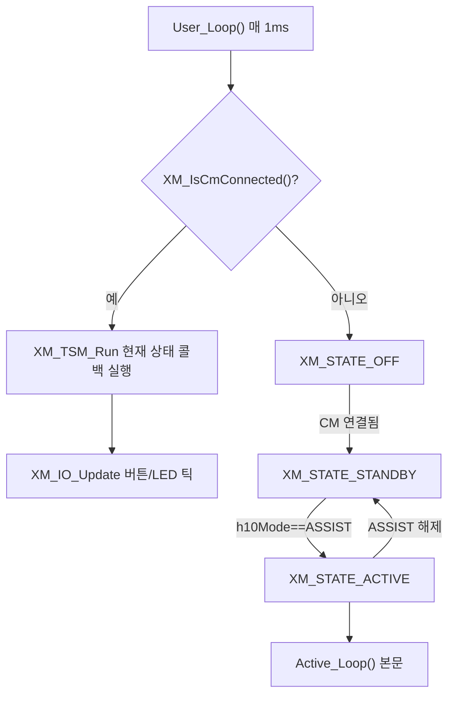
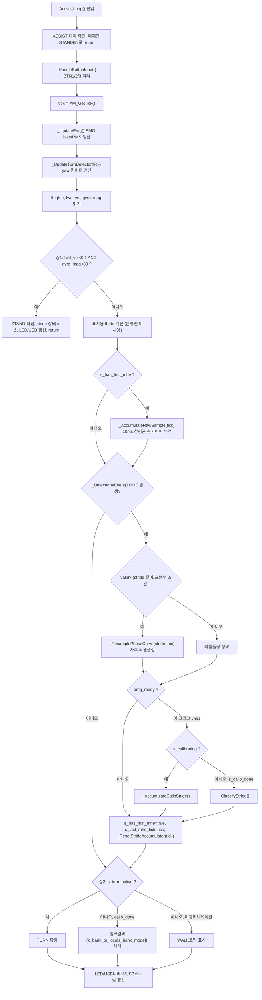
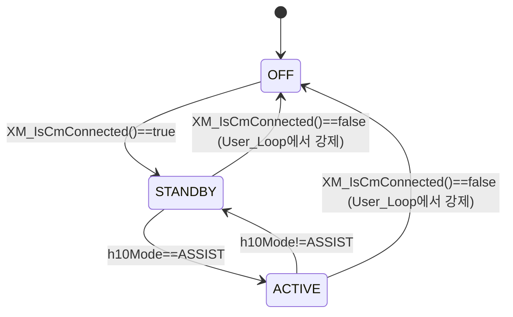

# Locomotion_Mode_Classifier.c — 20문항 퀴즈 해설서

> 대상 파일: `Locomotion_Mode_Classifier.c` (1418줄), `ref_curve_tables.h`
> 이 문서는 별도 대화에서 만든 "20문항 심화 퀴즈"의 정답 근거를 문제당 한 페이지 분량으로
> 풀어 쓴 해설서다. 0장에서 전체 구조와 실행 루프를 먼저 브리핑하고, 1장부터 문제별로
> 들어간다. 같은 함수를 여러 문제가 다룰 경우, 처음 등장한 문제에서 전문을 싣고 이후
> 문제에서는 "본문 코드는 N번 문제 참고"라고만 적는다.

> **2026-08-25 정정:** 이 해설서의 IDLE hard-veto 코드 예시는 구버전이다. 현행 C는
> 안정 보폭에 `MODE_CONFIRM_TH=0.35`, IDLE 전환 증거+현재와 다른 후보에
> `MODE_TRANSITION_CONFIRM_TH=0.15`를 적용해 같은 3/2 버퍼에 넣는다. 3/2 다수결은
> 변경되지 않았다. EMG는 H10 causal RMS를 유지하고 centered 기준표의 약 75 ms
> 군지연을 `_ReferenceThetaIndex()`에서 보폭별로 보상한다.

> [!warning]
> **v1.2 경계 변경:** 이 문서는 v1.1 당시의 20문항 해설을 보존한 역사 자료라
> 아래의 MHE stride 경계와 `pelvicAngle` 코드 예시는 현행 구현이 아니다.
> v1.2는 H10 `isRightFootContact` rising edge를 gcRight 기준곡선 경계로 쓰고,
> `TRUNK_TILT`에는 양측 `HipImuSagittalPitch` 평균을 사용한다. 현재 실행 흐름은
> `Locomotion_Mode_Classifier.md`, 전후 근거는 `IMPROVEMENT_REPORT.md`를 따른다.

---

# 0장. 전체 구조 브리핑

## 0.1 이 파일이 하는 일

H10 외골격이 고관절 IMU(6축 가속도/자이로 좌우 각 3축), 엔코더 기반 관절각
(`pelvicAngle`, `leftThighAngle`/`rightThighAngle`), 외부 ADC EMG 2자리(좌우 2채널씩,
합 4채널)만으로 매 1ms **7가지 보행 의도**를 실시간 분류한다. FSR(족압센서)은 쓰지 않는다.

```c
typedef enum {
    LOCO_STAND = 0,
    LOCO_WALK,
    LOCO_TURN,
    LOCO_STAIRS_UP,
    LOCO_STAIRS_DOWN,
    LOCO_RAMP_UP,
    LOCO_RAMP_DOWN,
    LOCO_MODE_COUNT
} LocoMode_t;
```

이 7-class 중 5개(WALK/STAIRS_UP/STAIRS_DOWN/RAMP_UP/RAMP_DOWN)만 `ref_curve_tables.h`의
위상 기준곡선과 z-score로 비교되고, 나머지 2개(STAND/TURN)는 완전히 다른 방식으로
판정된다. 이게 이 파일 전체를 이해하는 첫 번째 핵심이다 — **판정 경로가 모드마다 다르다.**

## 0.2 3층 판정 아키텍처 (정정된 우선순위 포함)

```
┌─────────────────────────────────────────────────────────────┐
│                Active_Loop() — 1ms 마다 처음부터 재실행           │
└─────────────────────────────────────────────────────────────┘
        │
        ▼
  [층 1] STAND 게이트  ── fwd_vel<0.1 && gyro_mag<30  ──▶ STAND 확정, 즉시 return
        │ (조건 거짓이면 통과)
        ▼
  위상 추정 · 원시버퍼 누적 · MHE 이벤트 시 stride 마감(사후 리샘플링→분류/캘리브레이션)
        │
        ▼
  [층 2] TURN 오버라이드 ── s_turn_active==true ──▶ TURN 확정
        │ (거짓이면)
        ▼
  [층 3] z-score 뱅크 결과 채택 (캘리브레이션 안 됐으면 WALK로만 표시)
```

**중요한 정정**: 이전에 그린 다이어그램 한 장에 "우선순위: TURN > STAND > 뱅크결과"라고
잘못 적었다. 실제 코드(`Active_Loop`, 655~665줄)는 STAND 게이트가 함수 맨 앞에서
조건을 검사하고, 참이면 그 자리에서 **즉시 `return`** 한다. TURN 오버라이드 블록은
그 아래(722~731줄)에 있어서 STAND 게이트를 통과하지 못하면 아예 도달하지 않는다.
따라서 실제 우선순위는 **STAND > TURN > 뱅크**다. 자세한 근거는 1번 문제에서 다룬다.

## 0.3 실행 루프 시각화

### 0.3.1 상태 전체 흐름 (mermaid)



### 0.3.2 `Active_Loop()` 내부 — 1ms 매 틱마다 정확히 이 순서로 실행



이 다이어그램이 곧 `Active_Loop()` 함수 본문 그 자체다(632~736줄). 아래 문제들은
이 흐름 위의 특정 지점들을 하나씩 확대해서 다룬다.

### 0.3.3 텍스트로 다시 — "1 stride"란 무엇인가

이 코드에서 시간 단위는 두 가지다: **1ms 틱**(위 다이어그램의 매 실행 단위)과
**1 stride**(오른쪽 허벅지가 한 번 최대로 신전했다가 다음 최대신전까지의 구간, MHE
이벤트로 경계가 잡힘). z-score 분류·캘리브레이션 누적·다수결 투표는 전부 **stride
단위**로 일어나고, 그 stride가 끝나는 순간(=MHE 이벤트 발생 시점)에 한꺼번에 처리된다.
1ms 틱 동안 하는 일은 신호를 읽고 원시버퍼에 쌓는 것뿐, 실제 "판단"은 stride 경계에서
만 벌어진다 — 이게 3번 문제(margin)와 20번 문제(메모리)를 이해하는 데도 중요하다.

## 0.4 자료구조 한눈에

```c
/* feature 4개 인덱스 — ref_curve_tables.h 에서 옴 */
typedef enum {
    RC_FEAT_TRUNK_TILT     = 0,  /* pelvicAngle [deg] */
    RC_FEAT_THIGH_GYROMAG  = 1,  /* sqrt(GyrX^2+GyrY^2+GyrZ^2) [deg/s] */
    RC_FEAT_EMG_SITE0_RMS  = 2,  /* gastrocnemius medialis RMS [V] */
    RC_FEAT_EMG_SITE1_RMS  = 3,  /* vastus medialis RMS [V] */
} RcFeature_t;

/* 뱅크 모드 5개 인덱스 */
typedef enum {
    RC_MODE_WALK = 0, RC_MODE_STAIRS_UP, RC_MODE_STAIRS_DOWN,
    RC_MODE_RAMP_UP, RC_MODE_RAMP_DOWN,
} RcMode_t;

/* feature별 런타임 도메인 보정 계수 */
typedef struct {
    float sign, scale, offset;
    bool  enabled;
} FeatureCalib_t;
```

`kRcMean[RC_MODE_COUNT][RC_FEATURE_COUNT][RC_THETA_POINTS]` 와 `kRcStd[...]` 가
`ref_curve_tables.h`에 정의된 실제 기준곡선 테이블이다(5×4×101, flash 상수 15.8KB).
이 구조를 계속 참조하니 먼저 익혀두면 아래 문제들이 훨씬 빨리 읽힌다.

---

# 1장. 문제별 해설

---

## 문제 1. STAND·TURN·뱅크 판정 우선순위

> STAND 게이트가 켜져있고(fwd<0.1, gyro<30) 동시에 TURN 검출기도 활성 상태
> (s_turn_active=true)라면 최종 판정은?
> **정답: STAND가 이긴다 (게이트가 함수 맨 앞에서 즉시 return)**

### 근거 코드 전문

```c
static void Active_Loop(void)
{
    if (XM.status.h10.h10Mode != XM_H10_MODE_ASSIST) {
        XM_SendUsbDebugMessage("[LMC] ASSIST 해제 -> STANDBY\r\n");
        XM_TSM_TransitionTo(s_tsm, XM_STATE_STANDBY);
        return;
    }

    _HandleButtonInput();

    uint32_t tick = XM_GetTick();

    _UpdateEmg();
    _UpdateTurnDetector(tick);

    float thigh_r  = XM.status.h10.rightThighAngle;
    float fwd_vel  = XM.status.h10.forwardVelocity;
    float gyro_mag = _HipGyroMagDps();

    /* ---------- 층 1: STAND 게이트 (기준곡선 미사용) ---------- */
    if ((fwd_vel < MIN_FWD_VELOCITY) && (gyro_mag < STAND_GYRO_TH_DPS)) {
        s_current_mode = LOCO_STAND;
        s_prev_thigh_r_deg = thigh_r;
        s_thigh_was_falling = false;
        s_rebound_deg = 0.0f;
        s_has_first_mhe = false;
        _ResetStrideAccumulator(tick);
        _UpdateLedIndicators();
        _UpdateUsbDebug();
        _UpdateStreamData();
        return;
    }

    /* ... (중략, 위상/MHE/분류 로직) ... */

    /* ---------- 층 2: TURN 이 뱅크 결과를 override ---------- */
    if (s_turn_active) {
        s_current_mode = LOCO_TURN;
    } else if (s_calib_done) {
        s_current_mode = k_bank_to_loco[s_bank_mode];
    } else {
        s_current_mode = LOCO_WALK;
    }

    _UpdateLedIndicators();
    _UpdateUsbDebug();
    _UpdateStreamData();
}
```

### 변수 하나하나

- `XM.status.h10.h10Mode` : H10 CM(Control Module)이 보고하는 현재 동작 모드(전역 구조체
  `XM.status.h10`의 필드). `XM_H10_MODE_ASSIST`와 다르면 사용자가 어시스트를 껐다는
  뜻이라, 이 함수의 나머지를 전부 건너뛰고 STANDBY로 되돌아간다.
- `tick` : `uint32_t`, `XM_GetTick()`이 반환하는 시스템 밀리초 카운터. 이 값을 기준으로
  모든 시간차(경과시간, stride 길이, 불응기간 등)를 계산한다.
- `thigh_r`, `fwd_vel`, `gyro_mag` : 이번 틱의 3개 핵심 원시신호를 지역변수로 캐시.
  이후 코드에서 `XM.status.h10.rightThighAngle`을 매번 다시 읽지 않고 이 지역변수를
  재사용한다(가독성 + 동일 틱 내 값 일관성 보장).
- `MIN_FWD_VELOCITY`(0.1f), `STAND_GYRO_TH_DPS`(30.0f) : `#define` 매크로 상수. `f`
  접미사는 C에서 이 리터럴이 `double`이 아니라 `float`임을 명시한다(임베디드에서
  `double` 연산은 느리거나 소프트웨어 에뮬레이션이라 `float`를 강제하는 관례).
- `s_current_mode` : 파일 전역 `static` 변수, `LocoMode_t` 타입. 이 값이 최종적으로
  LED·USB 스트림에 나가는 "지금 판정"이다.
- `s_turn_active` : `bool`, `_UpdateTurnDetector()`가 매 10ms 갱신하는 TURN 검출 상태.

### 문법 포인트

- **`if (...) { ...; return; }` 패턴**: 함수 중간에서 조건이 맞으면 나머지 로직을
  전부 건너뛰고 즉시 반환하는 "guard clause"(가드 절) 스타일이다. `if/else`로 전체를
  감싸는 대신 이렇게 쓰면 들여쓰기가 깊어지지 않고, "이 조건이면 다른 건 볼 필요도
  없다"는 의도가 코드 구조 자체로 드러난다.
- **논리곱 `&&`의 단락 평가(short-circuit)**: `fwd_vel < MIN_FWD_VELOCITY && gyro_mag <
  STAND_GYRO_TH_DPS`는 왼쪽이 거짓이면 오른쪽을 아예 평가하지 않는다. 여기선 두 계산
  다 저렴해서 성능상 의미는 적지만, 관례적으로 "값싼 조건을 먼저" 배치했다.
- **삼단 구조(층1→중략→층2)**: 함수 하나가 사실상 순차적인 "파이프라인"으로 짜여
  있다. C는 함수형 언어처럼 파이프를 문법으로 지원하지 않으므로, 위에서 아래로
  읽히는 순서 자체가 곧 실행 순서이자 우선순위라는 걸 기억해야 한다 — 이게 이
  문제의 핵심이다.

### 왜 이렇게 설계했는가

STAND는 "그 어떤 판정보다도 먼저, 그리고 확실하게" 걸려야 하는 안전 조건이다.
실제로 정지해 있는데 TURN이나 어떤 지형으로 오판되면(예: 서 있다가 몸을 살짝
돌리는 순간 TURN으로 잘못 고정), 향후 토크 제어가 붙었을 때 정지 상태에서 불필요한
보조가 나갈 위험이 있다. 그래서 코드 구조 자체를 "STAND 조건을 만족하면 다른 모든
로직을 아예 실행하지 않는다"로 만들어, 우선순위가 조건문 몇 개의 순서가 아니라
**함수의 제어 흐름 구조**로 강제되도록 했다. 실전에서는 회전 중엔 보통 gyro_mag가
30deg/s를 넘기 때문에 두 조건이 동시에 참이 되는 경우가 드물지만, 코드 차원의
안전장치는 "드문 경우"에도 정지가 항상 이긴다는 걸 보장한다.

---

## 문제 2. z-score 뱅크 핵심 수식

> z^m (모드 m의 최종 z-score)을 구하는 식으로 옳은 것은?
> **정답: z^m = sqrt( Σ_f w_f·(z_f^m)² / Σ_f w_f ), z_f^m 은 feature f의 위상평균 RMS z**

### 근거 코드 전문 (`_ClassifyStride`)

```c
static void _ClassifyStride(void)
{
    float z[RC_MODE_COUNT];

    for (uint8_t m = 0U; m < RC_MODE_COUNT; m++) {
        float acc = 0.0f;
        float wsum = 0.0f;

        for (uint8_t f = 0U; f < RC_FEATURE_COUNT; f++) {
            if (!s_calib[f].enabled) { continue; }

            float w = k_feature_weight[f];
            float feat_acc = 0.0f;
            uint16_t n = 0U;

            for (uint8_t i = 0U; i < RC_THETA_POINTS; i++) {
                if (s_obs_cnt[i] == 0U) { continue; }

                float x = s_obs_sum[f][i] / (float)s_obs_cnt[i];
                float xc = (s_calib[f].sign * s_calib[f].scale * x) + s_calib[f].offset;

                uint8_t j = (uint8_t)((i + s_phase_shift) % RC_THETA_POINTS);
                float d = (xc - kRcMean[m][f][j]) / kRcStd[m][f][j];
                feat_acc += d * d;
                n++;
            }

            if (n > 0U) {
                acc += w * (feat_acc / (float)n);
                wsum += w;
            }
        }

        z[m] = (wsum > 0.0f) ? sqrtf(acc / wsum) : 1e30f;
    }

    /* 1위 / 2위 찾기 */
    uint8_t best = 0U;
    for (uint8_t m = 1U; m < RC_MODE_COUNT; m++) {
        if (z[m] < z[best]) { best = m; }
    }
    float second = 1e30f;
    for (uint8_t m = 0U; m < RC_MODE_COUNT; m++) {
        if ((m != best) && (z[m] < second)) { second = z[m]; }
    }
    s_last_z_best = z[best];
    s_last_z_second = second;
    /* ... (margin, IDLE거부권, 투표는 3·4번 문제에서) ... */
}
```

### 수식으로 다시 쓰면

한 feature f, 위상 bin i 에서:

```
x(i)  = s_obs_sum[f][i] / s_obs_cnt[i]                (그 bin의 평균 측정값)
x_cal(i) = sign_f · scale_f · x(i) + offset_f          (도메인 보정, 11번 문제)
j     = (i + phase_shift) mod 101                      (위상 정렬)
d(i)  = ( x_cal(i) - kRcMean[m][f][j] ) / kRcStd[m][f][j]

z_f^m = sqrt( (1/n) · Σ_i d(i)² )                       (한 feature의 RMS z, n=유효 bin수)
z^m   = sqrt( Σ_f w_f·(z_f^m)² / Σ_f w_f )              (feature 가중 결합)
```

### 변수 하나하나

- `float z[RC_MODE_COUNT]` : 스택에 잡힌 지역 배열, 크기 5. 5개 모드 각각의 최종 z값을
  담는다. 함수가 끝나면 사라지는 임시 저장소다.
- `acc`, `wsum` : 모드 m에 대한 가중합의 분자·분모를 각각 누적하는 accumulator.
  이름 그대로 "누적기"다.
- `k_feature_weight[f]` : `static const float k_feature_weight[RC_FEATURE_COUNT] =
  {1.0f, 1.0f, 0.8f, 0.8f}` (IMU 2개는 1.0, EMG 2개는 0.8) — IMU는 항상 신뢰 가능하지만
  EMG는 전극 부착 상태·피로에 민감해서 가중치를 낮췄다.
- `s_calib[f].enabled` : `FeatureCalib_t` 구조체의 bool 필드. `MUSCLE_SITE_COUNT<2`면
  두 번째 EMG feature가 꺼져서 이 루프에서 `continue`로 건너뛴다(13번 문제와 연결).
- `feat_acc`, `n` : feature f 하나에 대한 위상 누적 제곱합과 유효 bin 개수.
  `s_obs_cnt[i]==0`인 bin(사후 리샘플링이 실패했거나 표본이 없는 위상)은 건너뛰므로
  `n`이 항상 101은 아닐 수 있다.
- `s_phase_shift` : `int`, 캘리브레이션에서 구한 위상 원점 오프셋(10번 문제). `j = (i +
  s_phase_shift) % RC_THETA_POINTS`로 온라인 위상 인덱스를 기준곡선 위상 인덱스로
  변환한다.
- `kRcMean[m][f][j]`, `kRcStd[m][f][j]` : `ref_curve_tables.h`의 3차원 `static const
  float` 배열. z-score의 분자(편차)와 분모(정규화 척도)를 각각 제공한다.
- `best`, `second` : 5개 z값 중 최솟값의 인덱스와 그다음으로 작은 값. "best가 가장
  잘 맞는 모드"라는 걸 코드로 그대로 구현한 것 — z-score는 "얼마나 다른가"이므로
  작을수록 더 유사하다.

### 문법 포인트

- **3중 중첩 `for` 루프**: 바깥부터 `m`(모드 5개) → `f`(feature 4개) → `i`(위상
  101개). 총 5×4×101=2020번의 내부 연산이 stride 하나가 끝날 때마다 딱 한 번 실행된다
  (1ms마다가 아니라 stride 완료 시에만 — 0.3.3절 참고).
- **`continue` 문**: 루프의 나머지 부분을 건너뛰고 다음 반복으로 넘어간다. 여기선
  "이 feature는 꺼져있다"(f 루프) 또는 "이 위상엔 표본이 없다"(i 루프)는 조건에서
  써서, 없는 데이터를 억지로 0으로 채우는 대신 아예 계산에서 배제한다.
- **삼항 연산자 `(wsum > 0.0f) ? sqrtf(acc / wsum) : 1e30f`**: "0으로 나누기"를
  막는 방어 코드다. 만약 모든 feature가 비활성화돼 `wsum`이 0이면(극단적 예외
  상황), z를 계산할 수 없으니 인위적으로 아주 큰 값(1e30f)을 넣어 "이 모드는
  아예 후보가 아니다"로 취급되게 한다. `1e30f`는 `float`가 표현 가능한 범위
  안에서 사실상 무한대 역할을 하는 관용적인 큰 수다.
- **`sqrtf` vs `sqrt`**: `f` 접미사가 붙은 버전은 `float` 인자를 받고 `float`를
  반환하는 함수(표준 C `<math.h>`). 인자가 `double`인 `sqrt`를 썼다면 암묵적으로
  `float→double` 변환, 계산, 다시 `double→float` 변환이 일어나 불필요하게
  느려진다. 임베디드 코드는 이런 `f` 접미사 함수를 일관되게 쓴다.

### 왜 이렇게 설계했는가

이건 본질적으로 **최근접 템플릿 매칭(nearest template matching)**이다. 5개 모드
각각이 "이 위상에서 이런 값이 나와야 한다"는 기준곡선(템플릿)을 갖고 있고, 실측
곡선과 그 템플릿의 거리(z-score, 즉 표준편차 단위로 정규화한 편차)를 재서 가장
가까운 템플릿을 고른다. 표준편차로 나누는 이유는 feature마다 단위와 변동폭이 다
달라서(각도는 수십 도, 각속도는 수 deg/s, EMG는 볼트 단위) 단순 절댓값 차이로는
비교가 불공평하기 때문이다. z-score로 정규화하면 "그 feature의 정상적인 변동폭
대비 얼마나 벗어났는가"라는 공통 척도가 생겨, 서로 다른 물리량 4개를 하나의
합산식(`z^m`)에 공정하게 섞을 수 있다.

---

## 문제 3. margin(tanh 압축)의 의미

> margin = tanh(sensitivity × margin_raw) 에서 margin_raw 는 무엇을 나타내는가?
> **정답: (second의 z - best의 z) / best의 z, 즉 1위와 2위 사이 상대적 격차**

### 근거 코드 전문 (`_ClassifyStride` 후반부, 2번 문제의 이어지는 부분)

```c
    s_last_z_best = z[best];
    s_last_z_second = second;

    /* ---------- 층 2.5: IDLE 거부권 (4번 문제) ---------- */
    s_last_z_idle = _ComputeIdleZ();
    s_in_transition = (s_last_z_idle < z[best]);

    /* 상대 마진 -> tanh 압축 */
    float denom = (z[best] > 1e-6f) ? z[best] : 1e-6f;
    float margin_raw = (second - z[best]) / denom;
    float sensitivity = k_sensitivity_scale[s_sensitivity_idx];
    s_last_margin = tanhf(sensitivity * margin_raw);

    if ((s_last_margin >= MODE_CONFIRM_TH) && !s_in_transition) {
        _PushVote(best);
        _UpdateModeFromVotes();
    }
```

### 변수 하나하나

- `denom` : `z[best]`가 혹시 0이거나 극히 작을 때 0나눗셈을 막는 방어 변수.
  `1e-6f`는 "사실상 0"으로 취급하는 하한선(부동소수점 오차 대비 안전 마진).
- `margin_raw` : `float`, 1위와 2위의 z값 차이를 1위의 z값으로 나눈 **상대 비율**.
  예를 들어 z_best=1.0, z_second=2.0이면 margin_raw=1.0(2위가 1위보다 100% 더
  나쁘다는 뜻), z_best=1.0, z_second=1.1이면 margin_raw=0.1(근소한 차이).
- `k_sensitivity_scale[s_sensitivity_idx]` : `{0.7f, 1.0f, 1.4f}` 3단계 배열에서
  BTN3로 고른 현재 배율. 이 값을 margin_raw에 곱해서 tanh에 넣기 전에 신호를
  "증폭"하거나 "완화"한다.
- `s_last_margin` : `tanhf(...)`의 결과, 이론상 -1~1 범위지만 `margin_raw`가 항상
  0 이상(second≥best는 정의상 항상 참이므로)이라 실질적으로 0~1 범위로 나온다.

### 문법 포인트

- **`tanhf` (하이퍼볼릭 탄젠트)**: 입력이 아무리 커져도 출력은 ±1을 절대 넘지
  않는 **포화 함수(saturating function)**다. 입력이 0 근처에서는 거의 선형(기울기
  ≈ sensitivity)이지만, 입력이 커질수록 기울기가 완만해져 1에 점근한다. 이 성질
  때문에 "margin_raw가 아무리 커져도 압축된 결과는 항상 다루기 쉬운 범위 안에
  머문다"는 게 보장된다.
- **왜 절댓값이 아니라 비율(상대값)인가**: `(second - best)`만 쓰면 z값 자체가
  크게 나오는 상황(예: 센서 노이즈가 커서 모든 z가 전반적으로 큰 세션)에서 격차의
  절대크기도 덩달아 커져, 고정 임계값(`MODE_CONFIRM_TH`)과 비교하기 어려워진다.
  best로 나눠 비율로 만들면 "1위가 2위보다 상대적으로 몇 % 더 나은가"라는, z값의
  전반적 스케일과 무관한 지표가 된다.

### 왜 이렇게 설계했는가

이 설계는 `Terrain_Intent_Classifier.c`(3-class 구버전)의 fuzzy score 패턴을
5-way 경쟁에 맞게 확장한 것이다. 구버전은 "오르막 성향 점수"와 "평지 성향 점수"
둘만 비교하면 됐지만, 지금은 5개 모드가 동시에 경쟁하므로 "1등이 뭐냐"보다
"1등이 2등을 얼마나 확실하게 이겼냐"가 신뢰도의 핵심이 된다. margin이 크면(1등이
압도적) 그 stride의 판정을 믿고 투표하고, margin이 작으면(1등과 2등이 엇비슷)
애매한 stride이니 투표를 보류한다(4번 문제). tanh로 압축하는 이유는 BTN3
민감도(sensitivity)를 곱했을 때 압축 후 값이 여전히 일정한 범위 안에 있어야
`MODE_CONFIRM_TH`라는 고정 임계값 하나로 세 가지 민감도 설정 모두를 커버할 수
있기 때문이다.

---

## 문제 4. 완충지대(MODE_CONFIRM_TH)

> margin < MODE_CONFIRM_TH(0.35) 인 stride가 발생하면 무슨 일이 일어나는가?
> **정답: 그 stride는 투표하지 않고, 다수결 버퍼는 직전 상태를 그대로 유지한다**

이 문제의 판정 로직은 **3번 문제의 코드 마지막 5줄**과 정확히 같은 부분이다
(`if ((s_last_margin >= MODE_CONFIRM_TH) && !s_in_transition) { _PushVote(best);
_UpdateModeFromVotes(); }`). 여기서는 그 조건문이 "왜 이렇게 설계됐는지"만 추가로
짚는다.

### 매크로 정의

```c
/* --- 분류 히스테리시스 (margin score: 0~1) ---
 * 3-class 였던 Terrain_Intent_Classifier.c 는 양방향 dual-threshold 였지만,
 * 여기는 5-way argmin 이라 "1위와 2위의 상대 마진"이 곧 확신도다.
 * 마진이 이 값에 못 미치는 stride 는 투표 자체를 하지 않아(완충지대)
 * 직전 다수결 상태가 유지된다 — 경계 지형에서의 flicker 방지. */
#define MODE_CONFIRM_TH         0.35f
```

### 문법 포인트

- `if (A && B) { 행동 }` 이고 `else`가 없다: 조건이 거짓이면 그냥 **아무것도
  하지 않고 함수가 끝난다.** 명시적으로 "직전 상태 유지"라는 코드를 쓸 필요가
  없다 — `s_bank_mode`를 아예 건드리지 않는 것 자체가 "유지"이기 때문이다. C에서
  "아무 것도 안 하기"가 종종 가장 자연스러운 방법이라는 걸 보여주는 예다.

### 구버전과의 차이 (dual-threshold → single-threshold)

`Terrain_Intent_Classifier.c`는 `score >= INCLINE_SCORE_TH(0.35)`면 오르막 투표,
`score <= LEVEL_SCORE_TH(0.15)`면 평지 투표, 그 사이(0.15~0.35)는 완충지대였다 —
즉 위아래 **두 개의 임계값**이 필요했다. 이번 파일은 5개 모드가 경쟁하는 구조라
"2등 대비 상대 마진"이라는 단일 지표 하나만 있으면 "얼마나 확신하는가"를 완전히
표현할 수 있어서, 임계값도 `MODE_CONFIRM_TH` 하나로 줄었다. 임계값 미만이면
그냥 투표를 안 하는 것으로 "완충지대"를 구현한 것이다.

### 왜 이렇게 설계했는가

전환 경계(예: 평지에서 계단으로 발을 딛는 순간) stride는 신호가 두 모드 사이에서
애매하게 걸쳐 있어 z값 차이가 작다. 이런 stride를 무리하게 "1등 모드"로 확정해
투표에 반영하면, 실제로는 아직 전환 중인데 성급하게 모드가 바뀌었다가 다음
stride에서 다시 바뀌는 flicker(깜빡임)가 생긴다. 완충지대는 "잘 모르겠으면 그냥
가만히 있는다"는 보수적 전략으로 이 문제를 막는다. 다만 이게 공짜는 아니다 —
애매한 stride가 계속되면 다수결 버퍼가 오래 안 채워져 전환이 늦어지는 트레이드
오프가 있고, 이건 5번 문제(다수결)와 직결된다.

---

## 문제 5. IMU_thigh_TILT 제외 이유

> 4개 feature 후보 중 IMU_thigh_TILT(허벅지 절대각)가 최종 선정에서 빠진 이유는?
> **정답: 모드별 평균이 전부 -85~-87도로 사실상 동일하고, 판별력이 heel-strike/toe-off
> 충격 스파이크에서만 나오는데 H10의 칼만 필터링된 값엔 그 스파이크가 없어서**

### 근거 코드 — 채택된 feature를 실제로 읽는 함수

```c
static float _SampleFeature(uint8_t feat_idx)
{
    switch (feat_idx) {
        case RC_FEAT_TRUNK_TILT:
            return XM.status.h10.pelvicAngle;

        case RC_FEAT_THIGH_GYROMAG:
            return _HipGyroMagDps();

        case RC_FEAT_EMG_SITE0_RMS:
            return s_emg_rms_v[EMG_CH_INDEX(0U, EMG_SIDE_R)];

        case RC_FEAT_EMG_SITE1_RMS:
#if (MUSCLE_SITE_COUNT >= 2U)
            return s_emg_rms_v[EMG_CH_INDEX(1U, EMG_SIDE_R)];
#else
            return 0.0f;
#endif
        default:
            return 0.0f;
    }
}
```

`RC_FEAT_THIGH_TILT`라는 case가 아예 없다는 것 자체가 증거다 — `RcFeature_t`
열거형에 4개(`TRUNK_TILT`, `THIGH_GYROMAG`, `EMG_SITE0_RMS`, `EMG_SITE1_RMS`)만
있고 허벅지 절대각(THIGH_TILT)은 열거값 자체가 존재하지 않는다.

### 파일 헤더 문서의 근거

```
 *   IMU_thigh_TILT      [제외] 모드별 평균이 전부 -85~-87 deg 로 사실상 동일
 *                       (DC 기여 -2%)하고, 판별력이 오직 heel-strike/toe-off
 *                       충격 스파이크 파형에서만 나온다. H10 의 leftThighAngle
 *                       은 CM 이 상보/칼만 융합한 매끈한 값이라 그 스파이크가
 *                       없다 => 템플릿 자체가 불일치. 넣으면 오히려 해롭다.
```

### 개념 설명 — "DC 기여율"이 뭔가

여기서 "DC"는 신호처리 용어로, 위상에 따라 변하는 성분(AC, 파형)이 아니라 위상
전체에 걸친 **평균값(상수 성분)**을 뜻한다. 어떤 feature의 판별력이 "DC 기여
50%"라는 건, 모드 간 z-score 차이의 절반이 그냥 "평균값이 다르다"에서 나오고
나머지 절반이 "파형 모양이 다르다"에서 나온다는 뜻이다. THIGH_TILT는 DC 기여가
**-2%**로 사실상 0이었다 — 즉 모드별 평균 자체는 거의 똑같고(-85~-87도로 겹침),
판별력이 있다면 전부 파형(순간적인 스파이크)에서 나와야 한다는 뜻이다.

### 문법/구조 포인트

- **`#if (MUSCLE_SITE_COUNT >= 2U)` 컴파일타임 조건**: `RC_FEAT_EMG_SITE1_RMS`
  case 안에 전처리기 조건이 들어있다. `MUSCLE_SITE_COUNT`가 1이면 이 case는
  `return 0.0f;`로 컴파일되어 실제 배열 접근(`s_emg_rms_v[EMG_CH_INDEX(1U,...)]`)
  코드 자체가 바이너리에 포함되지 않는다(13번 문제와 연결).
- **`switch`문에 없는 case = 존재하지 않는 feature**: C의 `switch`는 열거형의
  일부 값만 처리하고 나머지는 `default`로 보낼 수 있다. `RcFeature_t`에 THIGH_TILT
  값 자체가 없으므로 이 switch에 그 case가 없는 건 당연하다 — "일부러 뺐다"는
  증거는 `RcFeature_t` 정의(0.4절)와 파일 헤더 문서 쪽에 있다.

### 왜 이런 결론에 도달했는가 (분석 과정)

Camargo 원본 데이터의 IMU_thigh_TILT는 `atan2(AccX, AccZ)`로 계산된 각도인데,
원본 센서가 heel-strike/toe-off 순간의 충격을 그대로 기록해서 파형에 뾰족한
스파이크가 남는다. 반면 H10의 `leftThighAngle`/`rightThighAngle`은 CM이 상보
필터 또는 칼만 필터로 가속도-자이로를 융합해 만든 **매끈한** 추정치라 그런
충격 스파이크가 존재하지 않는다(1장 파일 헤더 3장 참고). 즉 두 신호는 "같은
물리량이지만 필터링 특성이 근본적으로 다른" 신호쌍이다. 기준곡선(템플릿)은
스파이크가 있는 원본으로 만들어졌는데 온라인 신호엔 그 스파이크가 없으므로,
이 feature를 z-score에 넣으면 실측값이 항상 템플릿의 스파이크 구간에서 크게
벗어난 것처럼 보여 z를 왜곡시킨다 — "판별력이 없는 정도"가 아니라 "적극적으로
해로운" feature라서 제외됐다.

---

## 문제 6. IMU_trunk_GYROMAG 제외 이유

> IMU_trunk_GYROMAG(체간 각속도 크기)가 최종 4개에서 빠진 이유는?
> **정답: d_subj 0.92로 판별력이 약했고, 유일한 강점이던 TURN 판별이 애초에 뱅크에서
> 빠졌기 때문**

`_SampleFeature()` 코드는 5번 문제와 동일 — `RcFeature_t`에 TRUNK_GYROMAG 항목
자체가 없다.

### 개념 설명 — "d_subj"란

이 세션 전체에서 반복적으로 쓰인 지표로, **피험자별로 따로 계산한 위상분해
Cohen's d의 중앙값**이다. Cohen's d는 두 그룹(여기선 두 모드)의 평균 차이를
표준편차로 나눈 표준화된 효과크기(effect size)로, 통계학에서 "이 차이가 실질적으로
얼마나 큰가"를 표현하는 표준 척도다:

```
d(theta) = ( mean_B(theta) - mean_A(theta) ) / sqrt( (std_A(theta)^2 + std_B(theta)^2) / 2 )
```

이걸 101개 위상점 전부에 대해 구한 뒤 RMS로 하나의 숫자로 압축한 게 "위상분해
Cohen's d"다. "d_subj"는 이걸 7명 피험자 각각에 대해 따로 계산한 뒤 중앙값을
취한 것 — 캘리브레이션(개인차 보정) 이후 기대할 수 있는 판별력에 해당한다.
trunk_GYROMAG의 d_subj가 0.92라는 건 채택된 feature들(예: trunk_TILT는 여러
쌍에서 2점대)에 비해 상당히 약했다는 뜻이다.

### 왜 이렇게 설계했는가

trunk_GYROMAG(체간의 3축 자이로 크기)가 상대적으로 쓸모 있었던 유일한 지점은
TURN 판별이었다 — 회전할 때 몸통이 함께 돌면서 각속도가 커지기 때문이다. 하지만
TURN 자체가 41개 feature 전부에서 판별력이 약해(TURN vs WALK 최대 Cohen's d
0.80) z-score 뱅크에서 완전히 빠지고 별도의 yaw 검출기로 이관됐다(0.2절). TURN
판별이라는 존재 이유가 사라졌으니 trunk_GYROMAG를 뱅크에 남겨둘 근거도 함께
사라진 것이다 — feature 선정이 "그 feature 하나의 절대적 가치"가 아니라
"지금 뱅크가 담당하는 5개 모드 조합에서의 상대적 가치"로 이뤄졌다는 걸 보여주는
사례다.

---

## 문제 7. shank/foot 하드웨어 제약의 실전 영향

> 무릎/발목 엔코더가 없어 shank/foot 계열 IMU feature를 복원할 수 없다는 하드웨어
> 제약은 실전에서 얼마나 문제가 됐는가?
> **정답: 15개 모드쌍 중 12쌍은 대체 손실 0%, 평균 손실 1.7%, 최대 11.2%로 실질적
> 영향이 거의 없었다**

이 문제는 `.c` 코드 자체보다는 **분석 과정의 결론이 코드(feature 선정)에 어떻게
반영됐는가**를 묻는다. 근거는 파일 헤더 문서에 있다.

### 근거 — 파일 헤더 2장

```
 *   IMU_shank / foot    [제외] 무릎/발목 엔코더가 없어 복원 불가.
 *                       단, 대체 손실은 15개 모드쌍 평균 1.7% 에 불과하다
 *                       (12쌍은 손실 0%, 최대 11.2%). 즉 이 하드웨어 제약은
 *                       실질적으로 문제가 되지 않는다.
```

### 분석 방법 요약 (코드 밖 근거)

`analyze_locomotion_bank.py`(별도 Python 스크립트)가 이 결론을 낸 방식은:
보행 6모드(WALK/TURN/STAIRS_UP/STAIRS_DOWN/RAMP_UP/RAMP_DOWN, 순서쌍이 아니라
조합이므로 15쌍) 각각에 대해 "41개 feature 전부 중 최강 판별력"과 "H10에서
실제로 얻을 수 있는 feature(shank/foot 제외)만 중 최강 판별력"을 나란히 계산해서
`손실율 = 1 - (가용feature최강d / 전체feature최강d)`를 구했다. 12쌍은 애초에
1위 feature가 shank/foot 계열이 아니어서 손실이 0%였고, 나머지 3쌍만 손실이
있었는데 그마저 최대 11.2%였다.

### 왜 이 결과가 중요한가

이 파일이 시작된 브리핑(사전 문서)은 shank/foot IMU 부재를 상당히 심각한
하드웨어 제약으로 취급했다 — "가장 강력한 판별 지표를 잃었으니 대체 feature를
찾아야 한다"는 전제였다. 하지만 실제로 데이터를 대조해보니 우려가 과장이었다.
이건 이 세션 전체를 관통하는 패턴이기도 하다 — 사전 브리핑의 여러 전제(STAND가
정지라는 것, TURN이 EMG 좌우 비대칭으로 개선 가능하다는 것, soleus가 gastrocnemius
와 동급이라는 것)가 실측으로 뒤집혔는데, 이 항목은 반대로 "걱정할 필요가 없었다"는
쪽으로 뒤집힌 몇 안 되는 사례다.

---

## 문제 8. EMG 근육 자리 선정 (gastrocnemius vs soleus)

> EMG 배선 자리 2개(MUSCLE_SITE_COUNT=2)로 최종 선정된 근육 조합은?
> **정답: gastrocnemius medialis + vastus medialis (데이터 기반 greedy 선택 1·2순위)**

### 근거 코드 — 상수 블록 주석과 `_SampleFeature`의 case 주석

```c
/* --- EMG 근육 자리 수 --------------------------------------------------
 * 자리를 늘릴 때 이 상수 하나만 바꾸면 된다(배열/루프는 전부 이 값 기준).
 * 1자리당 좌우 2채널(L/R). 외부 ADC 는 PF3~PF6 = XM_EXT_ADC_5~8 로 4채널이므로
 * 최대 2자리까지 외부 배선 가능. 3자리는 H10 내장 EMG 를 추가로 동원해야 한다.
 *
 * 자리 선택은 Camargo 7명 데이터의 greedy 최적화 결과를 따랐다:
 *   site0 = gastrocnemius medialis (15쌍 합계 gain +5.44, 압도적 1위)
 *   site1 = vastus medialis        (+0.72, 2위)
 * (참고: soleus 는 총 gain 0.83 으로 gastrocnemius 보다 훨씬 약했다.)
 * --------------------------------------------------------------------- */
#define MUSCLE_SITE_COUNT       2U
```

그리고 `_SampleFeature()`의 EMG case 주석에도 근육 이름이 명시돼 있다: "EMG
site0 (gastrocnemius medialis) RMS", "EMG site1 (vastus medialis) RMS" — 이건
`ref_curve_tables.h`의 `RC_FEAT_EMG_SITE0_RMS`/`SITE1_RMS` 열거값 주석에서 온
것이다.

### 개념 설명 — "greedy 최적화"란

여기서 쓰인 방식은 조합 최적화의 표준 근사법인 **탐욕(greedy) 알고리즘**이다:
"6모드 15쌍 각각에서 IMU만으로 얻는 최고 d를 기준선으로 놓고, 근육을 하나씩
추가할 때마다 15쌍 d 합계가 가장 많이 오르는 근육을 고른다"를 자리 수만큼
반복한다. 진짜 최적해(전체 11개 근육 중 2개를 고르는 55가지 조합을 전부 계산)를
구하는 게 아니라, "한 번에 하나씩, 지금 가장 좋아 보이는 걸 고른다"는 근사법이라
"탐욕적"이라 부른다. 계산량이 훨씬 적으면서도 실전에서 최적해에 가까운 답을
주는 경우가 많아 이런 조합 문제에 흔히 쓰인다.

### 브리핑과의 차이 — 왜 이게 중요한 검증 포인트인가

원래 사전 브리핑은 soleus(가자미근)를 tibialisanterior(전경골근)와 함께 1·2순위
후보로 지목했다. 하지만 실측 greedy 분석 결과 soleus의 총 gain은 0.83에
불과해, 1순위로 뽑힌 gastrocnemius medialis(+5.44)의 6분의 1도 안 됐다.
"soleus와 gastrocnemius는 둘 다 비복근/가자미근 계열이라 비슷하게 강할 것"이라는
직관적 가정이 실제 데이터로는 성립하지 않았다는 뜻이다. 이 발견이 없었다면
잘못된 근육에 하드웨어(외부 ADC 배선)를 낭비했을 수 있다 — 데이터 기반 검증이
설계 결정을 실질적으로 바꾼 사례다.

---

## 문제 9. EMG RMS 파이프라인

> `_UpdateEmg()`의 RMS 계산 파이프라인 순서로 옳은 것은?
> **정답: ADC 읽기(mV→V) → 진입 후 1초 bias 평균 추정 → bias 제거 → 제곱값 150샘플
> 이동합 → sqrt**

### 근거 코드 전문

```c
static void _UpdateEmg(void)
{
    float centered[EMG_CH_COUNT];

    for (uint8_t i = 0U; i < EMG_CH_COUNT; i++) {
        float raw_v = (float)XM_AnalogReadMillivolts(s_emg_pins[i]) * 0.001f;

        if (!s_emg_bias_ready) {
            s_emg_bias_sum[i] += raw_v;
            centered[i] = 0.0f;
        } else {
            centered[i] = raw_v - s_emg_bias_v[i];
        }
    }

    if (!s_emg_bias_ready) {
        s_emg_bias_cnt++;
        if (s_emg_bias_cnt >= EMG_BIAS_SETTLE_MS) {
            for (uint8_t i = 0U; i < EMG_CH_COUNT; i++) {
                s_emg_bias_v[i] = s_emg_bias_sum[i] / (float)s_emg_bias_cnt;
            }
            s_emg_bias_ready = true;
            XM_SendUsbDebugMessage("[LMC] EMG bias 추정 완료\r\n");
        }
        return;
    }

    for (uint8_t i = 0U; i < EMG_CH_COUNT; i++) {
        float sq = centered[i] * centered[i];
        s_emg_sq_sum[i] -= s_emg_sq_buf[i][s_emg_buf_idx];
        s_emg_sq_buf[i][s_emg_buf_idx] = sq;
        s_emg_sq_sum[i] += sq;

        uint16_t n = s_emg_buf_filled ? EMG_RMS_WINDOW_MS : (s_emg_buf_idx + 1U);
        float mean_sq = s_emg_sq_sum[i] / (float)n;
        if (mean_sq < 0.0f) { mean_sq = 0.0f; }
        s_emg_rms_v[i] = sqrtf(mean_sq);
    }

    s_emg_buf_idx++;
    if (s_emg_buf_idx >= EMG_RMS_WINDOW_MS) {
        s_emg_buf_idx = 0U;
        s_emg_buf_filled = true;
    }
}
```

### 변수 하나하나

- `float centered[EMG_CH_COUNT]` : 스택 배열(크기 4, `MUSCLE_SITE_COUNT=2` ×
  `EMG_SIDE_COUNT=2`). 이번 틱의 "bias 제거된" 전압을 임시로 담는다. 함수 안에서만
  쓰이고 다음 호출에는 남지 않는다(`static`이 아니라 지역 변수라서).
- `XM_AnalogReadMillivolts(s_emg_pins[i])` : XM API 함수, 정수 밀리볼트값을
  반환한다. `* 0.001f`로 볼트 단위로 환산한다.
- `s_emg_bias_ready` : `bool`, ACTIVE 진입 후 `EMG_BIAS_SETTLE_MS`(1000ms)가
  지났는지를 나타내는 플래그. 이 플래그가 꺼져 있는 동안은 `centered[i]=0.0f`로
  강제해서(아직 bias를 모르니 "중심화된 값"을 계산할 수 없다는 뜻) RMS 계산
  블록 자체를 건너뛴다.
- `s_emg_bias_sum[i]`, `s_emg_bias_cnt` : bias 추정 구간 동안 원시 전압을
  단순 누적하는 합과 그 개수. 구간이 끝나면 `sum/cnt`로 평균을 내 `s_emg_bias_v[i]`
  (채널별 DC 오프셋)를 확정한다.
- `s_emg_sq_buf[EMG_CH_COUNT][EMG_RMS_WINDOW_MS]` : 채널당 150개짜리 원형(순환)
  버퍼. "중심화된 값의 제곱"을 저장한다.
- `s_emg_sq_sum[i]` : 그 채널의 원형 버퍼 150개 값의 **합**을 항상 최신 상태로
  유지하는 누적기. 매 틱 "가장 오래된 값을 빼고 새 값을 더하는" 방식으로 O(1)에
  갱신한다(아래 문법 포인트).
- `s_emg_buf_idx`, `s_emg_buf_filled` : 원형 버퍼의 다음 쓰기 위치와 "버퍼가
  150개로 다 찼는가" 플래그. 버퍼가 아직 안 찼을 땐 `n`을 실제 채워진 개수
  (`s_emg_buf_idx+1`)로 써서 평균이 왜곡되지 않게 한다.

### 문법 포인트

- **원형 버퍼(circular buffer)의 O(1) 이동합 갱신**: `s_emg_sq_sum[i] -=
  s_emg_sq_buf[i][s_emg_buf_idx]; s_emg_sq_buf[i][s_emg_buf_idx] = sq;
  s_emg_sq_sum[i] += sq;` 세 줄이 핵심 트릭이다. "150개짜리 배열 전체를 매번
  다시 합산"하면 O(150)이 걸리지만, "이번에 덮어쓸 자리의 예전 값을 빼고 새
  값을 더하기"만 하면 매 틱 O(1)로 이동합을 유지할 수 있다. 1kHz(1ms)로 도는
  루프에서 이런 최적화는 필수적이다.
- **삼항 연산자로 만든 가변 분모**: `uint16_t n = s_emg_buf_filled ?
  EMG_RMS_WINDOW_MS : (s_emg_buf_idx + 1U);` — 버퍼가 아직 덜 찼으면(ACTIVE
  진입 직후) 실제 채워진 개수로 나누고, 다 찼으면 항상 150으로 나눈다. 이렇게
  안 하면 초반 몇 ms 동안 대부분 0인 배열을 150으로 나눠서 RMS가 비정상적으로
  작게 나온다.
- **`if (mean_sq < 0.0f) { mean_sq = 0.0f; }`**: 이론적으로 제곱의 합은 항상
  0 이상이어야 하지만, `float` 덧셈·뺄셈을 수백만 번 반복하면 부동소수점
  반올림 오차가 누적돼 아주 드물게 음수가 나올 수 있다. `sqrtf`에 음수를
  넣으면 `NaN`이 나오므로, 이 한 줄이 그 사고를 막는 방어 코드다.
- **함수 중간의 `return`**: bias가 아직 준비 안 됐으면(`!s_emg_bias_ready`)
  RMS 계산 블록(아래 절반)까지 갈 필요가 없어 그 전에 `return`한다 — 1번
  문제와 같은 가드 절 패턴이다.

### 왜 이렇게 설계했는가

EMG 신호는 전극-피부 접촉에 따라 개인마다, 심지어 부착할 때마다 DC 오프셋이
다르다. 이 오프셋을 빼지 않으면 "근육이 활성화됐다"는 신호(교류 성분)와
"전극이 어쩌다 이렇게 붙었다"는 잡음(직류 성분)을 구분할 수 없다. 그래서
매번 ACTIVE에 진입할 때마다 1초간 조용히 있는 구간의 평균을 그 세션의
bias로 잡는다. RMS 윈도우를 150ms로 고른 건 임의가 아니라, `ref_curve_tables.h`
를 만든 오프라인 파이프라인이 쓴 Camargo EMG envelope 윈도우(`ENV_WINDOW_S=
0.15`)와 정확히 맞춘 것이다 — 온라인에서 계산하는 RMS와 기준곡선을 만들 때
쓴 RMS의 "정의"(윈도우 길이) 자체가 다르면, 두 값을 z-score로 비교하는 것
자체가 성립하지 않기 때문이다.

---

## 문제 10. 캘리브레이션 위상 offset 추정

> 캘리브레이션에서 '위상 offset'(s_phase_shift)을 구할 때 4개 feature 중 어떤 것을
> 기준으로 삼는가?
> **정답: IMU_thigh_GYROMAG 하나만으로 원형 교차상관을 최대화하는 시프트를 찾고, 그
> 값을 모든 feature가 공유한다**

### 근거 코드 전문 (`_FinishCalibration`, 전체 — 11·12번 문제도 이 함수를 씀)

```c
static void _FinishCalibration(void)
{
    static float own[RC_FEATURE_COUNT][RC_THETA_POINTS];

    /* --- 1) 우리 자신의 WALK 위상곡선 확정 --- */
    for (uint8_t i = 0U; i < RC_THETA_POINTS; i++) {
        float inv = (s_calib_cnt[i] > 0U) ? (1.0f / (float)s_calib_cnt[i]) : 0.0f;
        for (uint8_t f = 0U; f < RC_FEATURE_COUNT; f++) {
            own[f][i] = s_calib_sum[f][i] * inv;
        }
    }

    /* 빈 bin 보간 */
    for (uint8_t f = 0U; f < RC_FEATURE_COUNT; f++) {
        for (uint8_t i = 0U; i < RC_THETA_POINTS; i++) {
            if (s_calib_cnt[i] > 0U) { continue; }
            uint8_t prev = (i == 0U) ? (RC_THETA_POINTS - 1U) : (i - 1U);
            uint8_t next = (uint8_t)((i + 1U) % RC_THETA_POINTS);
            own[f][i] = 0.5f * (own[f][prev] + own[f][next]);
        }
    }

    /* --- 2) 위상 offset 추정 --- */
    const float *ref = &kRcMean[RC_MODE_WALK][RC_FEAT_THIGH_GYROMAG][0];
    float ref_mean, ref_std, own_mean, own_std;
    (void)_CurveStats(ref, &ref_mean, &ref_std);
    (void)_CurveStats(&own[RC_FEAT_THIGH_GYROMAG][0], &own_mean, &own_std);

    int best_shift = 0;
    float best_corr = -1e30f;
    for (int k = 0; k < RC_THETA_POINTS; k++) {
        float acc = 0.0f;
        for (int i = 0; i < RC_THETA_POINTS; i++) {
            int j = (i + k) % RC_THETA_POINTS;
            acc += (own[RC_FEAT_THIGH_GYROMAG][i] - own_mean) * (ref[j] - ref_mean);
        }
        if (acc > best_corr) {
            best_corr = acc;
            best_shift = k;
        }
    }
    s_phase_shift = best_shift;

    /* --- 3) feature 별 sign / scale / offset (11번 문제) --- */
    for (uint8_t f = 0U; f < RC_FEATURE_COUNT; f++) {
        s_calib[f].enabled = true;
        s_calib[f].sign = 1.0f;
        s_calib[f].scale = 1.0f;
        s_calib[f].offset = 0.0f;

#if (MUSCLE_SITE_COUNT < 2U)
        if (f == RC_FEAT_EMG_SITE1_RMS) {
            s_calib[f].enabled = false;
            continue;
        }
#endif
        const float *rc = &kRcMean[RC_MODE_WALK][f][0];
        float rc_mean, rc_std, ow_mean, ow_std;
        bool rc_ok = _CurveStats(rc, &rc_mean, &rc_std);
        bool ow_ok = _CurveStats(&own[f][0], &ow_mean, &ow_std);

        if (!rc_ok || !ow_ok) {
            s_calib[f].enabled = false;
            continue;
        }

        float acc = 0.0f;
        for (int i = 0; i < RC_THETA_POINTS; i++) {
            int j = (i + s_phase_shift) % RC_THETA_POINTS;
            acc += (own[f][i] - ow_mean) * (rc[j] - rc_mean);
        }
        s_calib[f].sign = (acc >= 0.0f) ? 1.0f : -1.0f;
        s_calib[f].scale = rc_std / ow_std;
        s_calib[f].offset = rc_mean - (s_calib[f].sign * s_calib[f].scale * ow_mean);
    }

    s_calibrating = false;
    s_calib_done = true;
    /* ... USB 디버그 로그 출력 (생략) ... */
}
```

### 변수 하나하나

- `static float own[RC_FEATURE_COUNT][RC_THETA_POINTS]` : 함수 안에 선언됐지만
  `static`이라 함수 호출이 끝나도 메모리가 사라지지 않는다(스택이 아니라
  전역 데이터 영역에 잡힌다). 이 함수는 캘리브레이션 완료 시 딱 한 번만
  불리므로 굳이 `static`을 쓴 이유는 스택 사용량을 줄이기 위해서다 — 4×101×4B
  =1616B를 스택에 잡으면 다른 함수 호출과 겹쳐 스택 오버플로우 위험이
  커지는데, `static`으로 두면 그 위험이 없다.
- `s_calib_sum[f][i]`, `s_calib_cnt[i]` : BTN1 캘리브레이션 동안(`
  _AccumulateCalibStride`) 8 stride에 걸쳐 누적된 합과 그 위상 bin이 채워진
  stride 수. `inv = 1/cnt`로 나눠 평균을 낸다.
- **빈 bin 보간**: 8 stride 전부에서 특정 위상(`i`)에 표본이 안 들어왔을 수
  있다(`s_calib_cnt[i]==0`). 이럴 때 바로 양옆 위상(`prev`, `next`)의 평균으로
  대충 채운다 — 선형보간의 가장 단순한 형태.
- `ref` : `const float*` 포인터, `kRcMean[RC_MODE_WALK][RC_FEAT_THIGH_GYROMAG]`
  배열의 첫 원소 주소를 가리킨다. 포인터로 다루면 배열 복사 없이 원본을
  그대로 읽을 수 있다.
- `k` : 0~100까지 시도해보는 "얼마나 시프트할지" 후보. `j = (i + k) % 101`로
  `own`의 위상 i를 `ref`의 위상 j에 대응시킨다.
- `acc` (여기서는 상관 누적값) : `Σ (own(i)-own_mean)·(ref(j)-ref_mean)` —
  통계학의 **공분산(covariance)의 비정규화 버전**이다. 이 값이 클수록 두 곡선이
  "같은 모양으로 함께 움직인다"는 뜻이다.
- `best_shift`, `best_corr` : 100번의 시도 중 상관이 가장 컸던 시프트값과
  그때의 상관값을 기록해두는 변수.

### 문법 포인트

- **이중 `for` 루프로 구현한 원형 순환**: 바깥 루프(`k`)가 "시프트 후보",
  안쪽 루프(`i`)가 "그 시프트에서의 상관 계산"이다. 총 101×101=10,201번의
  곱셈-덧셈이 딱 한 번(캘리브레이션 완료 시점에만) 실행된다 — 1ms 루프
  안이 아니라서 이 정도 계산량은 문제가 안 된다.
- **모듈로 연산 `%`로 만든 원형 인덱스**: `(i + k) % RC_THETA_POINTS`는
  인덱스가 101을 넘으면 다시 0부터 순환하게 만든다. 위상은 "원(circle)"
  개념이라(θ=1.0 다음이 다시 θ=0.0) 일반적인 배열 인덱스 계산이 아니라
  이렇게 나머지 연산으로 감아줘야 한다 — "원형 교차상관"이라는 이름이
  여기서 나온다.
- **`(void)_CurveStats(...)`**: 함수가 반환하는 `bool` 값을 일부러 버리겠다는
  뜻을 명시하는 관용구다. 여기선 반환값(곡선이 평탄한지 여부)을 안 쓰고
  `out_mean`/`out_std` 출력 인자만 필요해서, "이 반환값을 무시하는 건 실수가
  아니라 의도"라는 걸 컴파일러의 미사용 경고 없이 표현한다.

### 왜 THIGH_GYROMAG 하나만 쓰는가 (설계 타당성)

위상 원점 차이(온라인은 MHE=허벅지 최대신전, 기준곡선은 Camargo의 heel-strike)는
**물리적으로 하나의 값**이다 — 신발이 땅에 닿는 순간과 다리가 가장 신전되는
순간 사이의 시간차는 걷는 방식이 아니라 생체역학적으로 거의 고정된 관계이므로,
어떤 feature로 재든 같은 시프트가 나와야 정상이다. 그렇다면 굳이 4개 feature
전부로 따로 시프트를 구할 필요가 없고, 가장 "깨끗한"(위상에 따라 뚜렷한 두
피크를 갖는, 노이즈가 적은) 신호 하나로 한 번만 구해서 공유하는 게 계산도
적고 더 안정적이다. THIGH_GYROMAG가 선택된 이유는 2장 문서에서 이미 밝혔듯
"θ=0.10과 θ=0.60~0.70에 물리적으로 타당한 두 피크를 갖는 깨끗한 파형"이기
때문이다 — 신호 자체가 원형 교차상관이 가장 잘 먹히는 형태다.

---

## 문제 11. sign/scale/offset 유도 방식

> feature별 sign/scale/offset(FeatureCalib_t)은 어떻게 구해지는가?
> **정답: 두 곡선의 평균·표준편차·상관부호만으로 sign=상관부호, scale=std비,
> offset=평균차 형태의 닫힌 식으로 구한다**

이 문제의 코드는 **10번 문제의 "3) feature별 sign/scale/offset"** 블록과
동일하다. 여기서는 그 세 줄의 수학적 의미만 파고든다.

```c
s_calib[f].sign = (acc >= 0.0f) ? 1.0f : -1.0f;
s_calib[f].scale = rc_std / ow_std;
s_calib[f].offset = rc_mean - (s_calib[f].sign * s_calib[f].scale * ow_mean);
```

### 수식으로 다시 쓰면

```
sign_f   = sign( Σ_i [own(i)-own_mean]·[ref(i+shift)-ref_mean] )
scale_f  = std(ref_WALK) / std(own_WALK)
offset_f = mean(ref_WALK) - sign_f · scale_f · mean(own_WALK)
```

이건 `x_cal = sign·scale·x + offset` 형태의 **1차 함수(선형 변환)**를 만드는
공식이다. 목표는 "own 곡선에 이 변환을 적용하면 ref 곡선과 평균·진폭이
일치하게 만들기"다.

### 왜 이 세 식으로 충분한가 (통계적 근거)

일반적으로 두 신호를 최대한 겹치게 하는 선형변환(a·x+b)을 구하는 표준적인
방법은 **최소제곱 회귀(least-squares regression)**다. 하지만 회귀는 대응하는
두 시계열의 개별 데이터쌍(101개 (own(i), ref(i)) 쌍)에 대해 반복적으로 오차를
최소화해야 해서 계산이 더 무겁다. 여기서 쓰인 방법은 그보다 훨씬 가벼운
**"두 곡선의 요약통계량(평균, 표준편차, 상관 부호)만으로 만드는 어파인
변환"**이다:

- **scale**: "표준편차 비율"은 두 곡선의 "흔들리는 폭"을 맞추는 가장 직관적인
  방법이다. own 곡선의 진폭이 ref보다 작으면 scale>1로 키우고, 크면 scale<1로
  줄인다.
- **sign**: 상관의 부호는 "두 곡선이 같은 방향으로 움직이는가(양의 상관) 아니면
  반대로 움직이는가(음의 상관)"를 판정한다. 좌표축 정의가 반대인 경우(예: 각도의
  증가 방향을 반대로 잡은 센서)를 이 한 줄로 흡수한다.
- **offset**: scale과 sign을 적용한 뒤 own의 평균을 ref의 평균 위치로 옮겨주는
  이동량이다.

이 세 계수만으로는 "파형의 세부 모양"까지 완벽히 맞추지는 못하지만(그건 회귀가
더 잘한다), **평균과 진폭이라는 두 가지 핵심 차원**만 정렬해도 z-score 비교의
전제(같은 스케일, 같은 방향)를 충족시키기엔 충분하고, MCU에서 반복 최적화 없이
즉시 계산 가능하다는 실용적 이점이 크다.

### 왜 이렇게 설계했는가

이건 "정확도와 계산비용의 트레이드오프"에서 의도적으로 계산비용 쪽을 택한
결정이다. 온보드 MCU(1kHz 실시간 루프를 도는 자원 제한적인 임베디드 프로세서)
에서 8 stride 데이터로 반복적 최적화(경사하강법 등)를 돌리는 건 부담이 크고,
캘리브레이션은 사용자가 BTN1을 누르고 잠깐 기다리는 상호작용이라 응답성도
중요하다. 평균/표준편차/상관부호는 이미 앞 단계(`_CurveStats`, 위상 offset
계산)에서 어차피 구하던 값들이라 추가 계산이 거의 없다시피 하면서, z-score의
전제(단위/부호 일치)는 확실히 만족시킨다 — "필요한 만큼만 정확하게, 최소
계산으로"라는 임베디드 설계 철학이 드러나는 대목이다.

---

## 문제 12. 왜 WALK 곡선 하나로만 캘리브레이션하는가

> 캘리브레이션 시 5개 뱅크 모드 곡선 중 어떤 것을 기준으로 맞추는가?
> **정답: WALK 곡선 하나만을 기준으로 sign/scale/offset을 구하고, 나머지 4모드에도
> 동일 계수를 적용한다**

코드 근거는 10·11번 문제와 동일한 `_FinishCalibration()`이다 — `kRcMean[RC_MODE_
WALK][f]`로 **항상 `RC_MODE_WALK`만** 인덱싱한다는 점에 주목하면 된다
(`STAIRS_UP`이나 `RAMP_DOWN`으로 인덱싱하는 코드는 이 함수 어디에도 없다).

### BTN1 프로토콜과의 연결

```c
static void _StartCalibration(void)
{
    s_calibrating = true;
    s_calib_done = false;
    s_calib_stride_idx = 0U;
    memset(s_calib_sum, 0, sizeof(s_calib_sum));
    memset(s_calib_cnt, 0, sizeof(s_calib_cnt));
    XM_SendUsbDebugMessage("[LMC] 캘리브레이션 시작 — 평지에서 8 stride 걸어주세요\r\n");
}
```

디버그 메시지에 이미 답이 있다 — "**평지에서** 8 stride 걸어주세요"다. 사용자가
실제로 수행하는 동작 자체가 WALK뿐이므로, `_AccumulateCalibStride()`가 쌓는
`s_calib_sum`/`s_calib_cnt`는 물리적으로 WALK 위상곡선일 수밖에 없다. 코드가
"5모드 중 WALK를 선택"한 게 아니라,애초에 캘리브레이션 절차 자체가 WALK
데이터만 만들어내도록 설계됐다.

### 왜 이렇게 설계했는가 — 대안과 비교

만약 5모드 전부에 대해 개별 캘리브레이션을 하려면 사용자가 실제로 계단을
오르내리고 경사로를 오르내리는 과정을 캘리브레이션 절차에 포함해야 한다.
이건 (1) 설치 현장에 계단/경사로가 항상 있으리라는 보장이 없고, (2) 캘리브레이션
소요 시간이 5배로 늘어나며, (3) 무엇보다 사용자 경험이 나빠진다(제품을 처음
쓰는 사람에게 "계단을 오르내리며 초기설정을 하세요"라고 요구하는 건 비현실적).

이 설계가 성립하는 이유는 캘리브레이션이 보정하려는 것(단위 차이, 좌표계
부호, 개인별 신호 진폭)이 **모드에 무관한 물리적/개인적 특성**이기 때문이다.
"내 EMG 전극이 남들보다 신호가 세게 잡힌다"거나 "H10의 gyro 단위가 deg/s라
Camargo의 rad/s와 다르다"는 사실은 사용자가 계단을 오르든 평지를 걷든 똑같이
적용된다. 따라서 WALK 하나에서 구한 계수를 5모드 전체에 재사용해도 원리적으로
타당하다 — 다만 이건 "모드 간 파형의 세부 형태 차이"까지는 보정하지 못한다는
근사임을 감안해야 한다(11번 문제에서 다룬 계산비용 트레이드오프와 같은 맥락).

---

## 문제 13. MUSCLE_SITE_COUNT 확장성 설계

> MUSCLE_SITE_COUNT를 2에서 1로 낮추면 코드에서 실제로 일어나는 일은?
> **정답: EMG_CH_COUNT/ADC 핀 배열이 자동으로 줄고, RC_FEAT_EMG_SITE1_RMS가 #if
> 가드로 비활성화되며 z-score 계산에서도 자동으로 제외된다**

### 근거 코드 — 매크로 정의부

```c
#define MUSCLE_SITE_COUNT       2U
#define EMG_SIDE_COUNT          2U      /* R, L */
#define EMG_CH_COUNT            (MUSCLE_SITE_COUNT * EMG_SIDE_COUNT)
#define EMG_SIDE_R              0U
#define EMG_SIDE_L              1U
#define EMG_CH_INDEX(site, side)  (((site) * EMG_SIDE_COUNT) + (side))
```

### 이 상수 하나가 영향을 미치는 지점 3곳

**① ADC 핀 배열 크기**

```c
static const XmAdcPin_t s_emg_pins[EMG_CH_COUNT] = {
    XM_EXT_ADC_5,   /* PF3 : site0 R */
    XM_EXT_ADC_6,   /* PF4 : site0 L */
#if (MUSCLE_SITE_COUNT >= 2U)
    XM_EXT_ADC_7,   /* PF5 : site1 R */
    XM_EXT_ADC_8,   /* PF6 : site1 L */
#endif
};
```

**② `_SampleFeature()`의 두 번째 EMG feature (5번 문제에서 본 코드)**

```c
case RC_FEAT_EMG_SITE1_RMS:
#if (MUSCLE_SITE_COUNT >= 2U)
    return s_emg_rms_v[EMG_CH_INDEX(1U, EMG_SIDE_R)];
#else
    return 0.0f;
#endif
```

**③ `_FinishCalibration()`의 강제 비활성화 (10번 문제 코드의 일부)**

```c
#if (MUSCLE_SITE_COUNT < 2U)
    if (f == RC_FEAT_EMG_SITE1_RMS) {
        s_calib[f].enabled = false;
        continue;
    }
#endif
```

### 문법 포인트 — 전처리기 조건부 컴파일의 3단 활용

- `#if (MUSCLE_SITE_COUNT >= 2U) ... #endif` : **컴파일 시점**에 결정되는 조건이다.
  `MUSCLE_SITE_COUNT`가 1이면 이 블록 안의 코드는 애초에 **오브젝트 코드로
  변환조차 되지 않는다** — 런타임에 `if`로 건너뛰는 게 아니라, 컴파일러가
  그 텍스트를 아예 못 본 것처럼 처리한다. 그래서 배열 크기(`s_emg_pins`)처럼
  "런타임에 바꿀 수 없는" 것도 이 매크로로 제어할 수 있다.
- 반대 조건 `#if (MUSCLE_SITE_COUNT < 2U)` : `_FinishCalibration()`에서는
  "자리가 모자라면" 쪽을 컴파일하는 반대 방향 가드를 썼다. 두 곳에서 각각
  "있으면 쓴다"/"없으면 끈다"로 짝을 맞춘 것이다.
- **`enabled` 플래그를 통한 런타임 전파**: `#if`는 컴파일타임에 결정되지만,
  `s_calib[f].enabled = false`는 런타임 값이다. 이 값이 `_ClassifyStride()`와
  `_ComputeIdleZ()`의 `if (!s_calib[f].enabled) { continue; }`로 이어지므로,
  "컴파일타임에 존재 자체가 지워진 feature"의 정보가 "런타임에 계산에서
  제외된다"는 동작으로 자연스럽게 이어진다. 컴파일타임 상수 하나가 런타임
  분기 전체를 지배하는 구조다.

### 왜 이렇게 설계했는가

브리핑 단계에서 EMG 채널/자리 수가 아직 미정이었다(하드웨어 배선이 최종
확정되지 않은 상태). "나중에 자리 수가 바뀔 수 있다"는 불확실성에 대응하려면
자리 수를 하드코딩하지 않고 **상수 하나로 전체 시스템이 따라 움직이도록**
설계해야 한다. 이 파일은 `MUSCLE_SITE_COUNT`를 정의부 맨 위에 두고, 그 값에
파생되는 모든 것(채널 수, 핀 배열, feature 활성화 여부)을 `#if`와 매크로
연산으로 자동 계산하게 만들어, 실제 배선이 바뀌어도 이 상수 하나만 고치면
나머지 코드는 전혀 손댈 필요가 없다. "설정 하나, 파급 전체"라는 소프트웨어
설계 원칙(DRY, Don't Repeat Yourself)의 임베디드 버전이다.

---

## 문제 14. XM_IO_Update() 미호출 버그

> User_Loop()에서 XM_IO_Update()를 호출하지 않으면 어떤 문제가 생기는가?
> **정답: XM_GetButtonEvent()가 항상 NONE을 반환해 BTN1~3이 전혀 동작하지 않는다**

### 근거 코드 전문 (`User_Loop`)

```c
void User_Loop(void)
{
    if (!s_tsm) {
        return;
    }

    if (!XM_IsCmConnected()) {
        XM_TSM_TransitionTo(s_tsm, XM_STATE_OFF);
    }

    XM_TSM_Run(s_tsm);

    /* [필수] 버튼 디바운싱 + LED 효과 타이머 틱.
     * 호출하지 않으면 XM_GetButtonEvent() 가 항상 NONE 이 되어 BTN1~3 이 죽는다. */
    XM_IO_Update();
}
```

### 변수/호출 하나하나

- `s_tsm` : `XmTsmHandle_t` 타입, `User_Setup()`에서 `XM_TSM_Create()`로 만든
  상태머신 핸들. `!s_tsm`(포인터가 NULL인지 검사)이 참이면 상태머신 생성
  자체가 실패한 것이므로, 그 아래 아무 것도 실행하지 않고 즉시 return —
  NULL 포인터를 역참조하면 하드폴트(HardFault, 임베디드에서 프로그램이
  죽는 상황)가 나므로 이걸 막는 방어 코드다.
- `XM_IsCmConnected()` : CM(Control Module, H10 본체 제어보드)과의 통신이
  살아있는지 확인하는 함수. 연결이 끊기면 상태를 강제로 OFF로 되돌린다.
- `XM_TSM_Run(s_tsm)` : 현재 상태(OFF/STANDBY/ACTIVE)에 등록된 `on_loop`
  콜백을 실행한다 — 실질적으로 이 한 줄이 `Off_Loop`/`Standby_Loop`/
  `Active_Loop` 중 하나를 부른다.
- `XM_IO_Update()` : 이 함수가 실제로 버튼 입력을 "디바운싱"(짧은 순간의
  신호 떨림을 걸러 진짜 클릭인지 판정)하고 LED의 점멸 타이머를 진행시킨다.

### 왜 이게 실제 발견된 버그였는가

이 파일이 참고한 원본 패턴 파일(`D:\HARfinal\XM_Apps\User_Algorithm\Terrain_
Intent_Classifier.c`)에는 `User_Loop()`에 `XM_TSM_Run()`만 있고 `XM_IO_Update()`
호출이 아예 없었다. XM API 문서(`xm_api_led_btn.h`)에는 "이 함수는 설정만
변경하며, 실제 동작은 XM_IO_Update()에 의해 처리됩니다"라는 주석이 있는데,
이걸 호출하지 않으면 `XM_GetButtonEvent()`가 내부적으로 갱신되지 않아 항상
`NONE`(아무 이벤트 없음)을 반환한다. 즉 원본 파일은 BTN1(캘리브레이션 시작)이
물리적으로 눌러도 절대 반응하지 않는 상태였다는 뜻이다. 이번 파일을 작성하며
XM API 헤더를 직접 확인하는 과정에서 이 문제를 발견했고, `User_Loop()`에
`XM_IO_Update()`를 명시적으로 추가해 고쳤다.

### 왜 이런 실수가 나기 쉬운가 (설계 교훈)

`XM_GetButtonEvent()`만 보면 "버튼 상태를 읽는 함수"처럼 보여서, 이 함수를
호출하는 쪽(`_HandleButtonInput()`)만 있으면 충분할 것 같은 착각을 하기
쉽다. 하지만 실제로는 "상태를 읽는 함수"와 "그 상태를 갱신하는 함수"가
분리돼 있고, 후자를 빠뜨리면 전자가 항상 같은(초기) 값만 반환한다 — 이런
"읽기/갱신 분리형 API"는 임베디드 프레임워크에서 흔한 패턴이라, 새 파일을
작성할 때마다 이 호출을 빠뜨리지 않았는지 점검하는 습관이 필요하다.

---

## 문제 15. .cproject excluding 목록

> .cproject의 excluding 목록이 존재하는 이유는?
> **정답: User_Algorithm 폴더의 여러 .c 파일이 각각 User_Setup/User_Loop를 정의하므로,
> 동시에 여러 개가 컴파일되면 심볼 충돌이 나서 한 번에 하나만 남기고 나머지를 제외해야
> 하기 때문**

이 문제는 `.c` 파일이 아니라 빌드 설정 파일(`.cproject`, XML)이 근거다.

### 근거 — .cproject의 실제 구조 (요약)

```xml
<entry excluding="User_Algorithm/Final_Compensation_AddOn.c|
User_Algorithm/Final_EMG.c|User_Algorithm/Final_Encoder_ex01.c|
User_Algorithm/Final_FSR.c|User_Algorithm/Final_FSR_Fuzzy_Logic.c|
... (그 외 여러 파일) ..."
       kind="sourcePath" name="XM_Apps"/>
```

`excluding` 속성값은 파이프(`|`)로 구분된 경로 목록이다. 이 목록에 이름이
**들어있는** 파일은 컴파일에서 **빠지고**, 목록에 없는 파일만 실제로
컴파일된다. `Locomotion_Mode_Classifier.c`를 새로 추가할 때는 원래 컴파일
대상이었던 `Final_FSR_Fuzzy_Logic.c` 등 기존 활성 파일들을 이 목록에 새로
집어넣고, 새 파일의 이름은 목록에서 빼는(=넣지 않는) 방식으로 "빌드 타겟"을
전환했다.

### 왜 이런 제약이 있는가

`User_Algorithm` 폴더의 각 `.c` 파일(`Final_EMG.c`, `Final_FSR_Fuzzy_Logic.c`,
`user_app.c`, 그리고 이번에 만든 `Locomotion_Mode_Classifier.c` 등)은 전부
자기만의 `void User_Setup(void)`와 `void User_Loop(void)`를 정의한다. C
언어의 링크 규칙상, 같은 이름의 전역 함수(심볼)가 두 개 이상의 오브젝트
파일에 정의돼 있으면 **링커가 "중복 정의" 에러를 내고 빌드가 실패**한다.
이 프로젝트는 "여러 알고리즘 예제를 한 저장소에 보관하되, 실제로 펌웨어에
들어가는 건 항상 딱 하나"라는 구조를 택했고, 그 선택을 강제하는 메커니즘이
바로 이 `excluding` 목록이다 — 소스 코드 자체를 지우거나 옮기지 않고도
"지금 활성화된 파일이 무엇인가"를 이 한 줄의 설정으로 관리할 수 있다.

---

## 문제 16. TSM 3상태와 전이 조건

> XM_TSM(Task State Machine)의 3개 상태와 전이 조건으로 옳은 것은?
> **정답: OFF(CM 미연결)→STANDBY(CM 연결됨)→ACTIVE(h10Mode==ASSIST), ASSIST 해제 시
> 다시 STANDBY로**

### 근거 코드 전문

```c
void User_Setup(void)
{
    s_tsm = XM_TSM_Create(XM_STATE_OFF);

    XmStateConfig_t off_conf = { .id = XM_STATE_OFF, .on_loop = Off_Loop };
    XM_TSM_AddState(s_tsm, &off_conf);

    XmStateConfig_t sb_conf = { .id = XM_STATE_STANDBY, .on_loop = Standby_Loop };
    XM_TSM_AddState(s_tsm, &sb_conf);

    XmStateConfig_t act_conf = {
        .id       = XM_STATE_ACTIVE,
        .on_entry = Active_Entry,
        .on_loop  = Active_Loop,
        .on_exit  = Active_Exit
    };
    XM_TSM_AddState(s_tsm, &act_conf);
    /* ... USB메타/ADC설정/컨트롤모드 (19·20번 문제 등) ... */
}

static void Off_Loop(void)
{
    if (XM_IsCmConnected()) {
        XM_SendUsbDebugMessage("[LMC] CM 연결됨 -> STANDBY\r\n");
        XM_SetLedEffect(XM_LED_1, XM_LED_HEARTBEAT, 1000);
        XM_TSM_TransitionTo(s_tsm, XM_STATE_STANDBY);
    }
}

static void Standby_Loop(void)
{
    if (XM.status.h10.h10Mode == XM_H10_MODE_ASSIST) {
        XM_SendUsbDebugMessage("[LMC] ASSIST 감지 -> ACTIVE\r\n");
        XM_TSM_TransitionTo(s_tsm, XM_STATE_ACTIVE);
    }
}
```

`Active_Entry`/`Active_Loop`/`Active_Exit`는 각각 0.3절, 1번 문제, 아래에서
다룬다. ACTIVE 안에서 ASSIST가 풀리면(1번 문제 코드의 맨 위) `STANDBY`로
돌아간다.

### 상태 다이어그램



### 변수/구조체 하나하나

- `XmStateConfig_t` : XM API가 정의한 구조체 타입. `.id`(상태 식별자),
  `.on_entry`/`.on_loop`/`.on_exit`(각각 그 상태에 "들어올 때", "매 틱",
  "나갈 때" 호출되는 함수 포인터) 필드를 가진다.
- **지정 초기화자(designated initializer)** `{ .id = XM_STATE_OFF, .on_loop
  = Off_Loop }` : C99부터 지원하는 문법으로, 구조체 필드 이름을 명시하며
  초기화하는 방식이다. 순서를 안 지켜도 되고, 언급하지 않은 필드(`.on_entry`,
  `.on_exit`)는 자동으로 0(함수 포인터의 경우 NULL)이 된다. OFF와 STANDBY는
  `on_loop`만 필요하고 진입/퇴장 시 특별히 할 일이 없어서 이 두 필드를
  아예 생략했다 — ACTIVE만 세 콜백을 전부 등록한다.
- `XM_TSM_Create(XM_STATE_OFF)` : 상태머신을 만들면서 시작 상태를 OFF로
  지정한다. 반환값이 `s_tsm`에 저장된다.
- `XM_TSM_AddState(s_tsm, &off_conf)` : 방금 만든 설정 구조체의 **주소**를
  넘긴다(`&`) — TSM 라이브러리가 이 구조체 내용을 복사해가거나 참조를
  들고 있는다는 뜻. 지역 변수(`off_conf`)의 주소를 넘기는 게 안전한 이유는
  `User_Setup()`이 프로그램 시작 시 딱 한 번 불리고, 그 안에서 등록이 끝난
  뒤에는 원본 구조체가 더 이상 필요 없는 구조이기 때문이다(단, 이는 TSM
  구현이 내용을 복사한다는 전제 하에 안전하다).
- `XM_TSM_TransitionTo(s_tsm, XM_STATE_STANDBY)` : 상태를 강제로 바꾸는
  API. 호출되면 현재 상태의 `on_exit`(있다면), 새 상태의 `on_entry`(있다면)
  가 순서대로 실행된 뒤 다음 틱부터 새 상태의 `on_loop`가 불린다.

### 왜 이렇게 설계했는가

이건 임베디드에서 아주 흔한 **명시적 유한 상태 기계(FSM)** 패턴이다. 만약
상태를 `if/else`나 `switch`로 직접 관리했다면, "지금 OFF인데 갑자기 ACTIVE
관련 코드가 실행되는" 실수(상태 불변식 위반)가 코드 여기저기서 생길 수
있다. TSM 프레임워크를 쓰면 "이 상태에서는 이 함수만 불린다"는 게 구조적으로
보장되고, 상태 전이 로직(`Off_Loop`/`Standby_Loop`의 조건문)과 각 상태의
실제 동작(`Active_Loop`)이 코드로 분리되어 가독성도 좋아진다. OFF/STANDBY가
`on_entry`/`on_exit`를 안 쓰는 이유는 그 상태들은 "특별한 초기화나 정리
없이 그냥 대기"하기 때문이고, ACTIVE만 `on_entry`(EMG bias 재추정, MHE
상태 초기화 등)와 `on_exit`(LED 원복)가 필요한 건 그 상태에서만 "실제로
움직이는" 자원(원시버퍼, EMG 파이프라인, 투표 버퍼)들이 있기 때문이다.

---

## 문제 17. BTN1/2/3 기능

> BTN1, BTN2, BTN3 각각의 기능은?
> **정답: BTN1=캘리브레이션 시작, BTN2=투표버퍼·뱅크모드·TURN상태 리셋, BTN3=민감도
> 3단계(0.7/1.0/1.4배) 순환**

### 근거 코드 전문 (`_HandleButtonInput`)

```c
static void _HandleButtonInput(void)
{
    if (XM_GetButtonEvent(XM_BTN_1) == XM_BTN_CLICK) {
        _StartCalibration();
    }

    if (XM_GetButtonEvent(XM_BTN_2) == XM_BTN_CLICK) {
        s_vote_idx = 0U;
        s_vote_filled = 0U;
        s_bank_mode = RC_MODE_WALK;
        s_turn_active = false;
        XM_SendUsbDebugMessage("[LMC] BTN2: 투표/모드 리셋\r\n");
    }

    if (XM_GetButtonEvent(XM_BTN_3) == XM_BTN_CLICK) {
        s_sensitivity_idx = (uint8_t)((s_sensitivity_idx + 1U) % NUM_SENSITIVITY_LEVELS);
        char buf[48];
        snprintf(buf, sizeof(buf), "[LMC] BTN3: 민감도 = %.1fx\r\n",
                 (double)k_sensitivity_scale[s_sensitivity_idx]);
        XM_SendUsbDebugMessage(buf);
    }
}
```

### 변수 하나하나

- `XM_GetButtonEvent(XM_BTN_1)` : 이 버튼에 대해 "이번 틱에 어떤 이벤트가
  있었는가"를 반환하는 함수. `XM_BTN_CLICK`(짧게 눌렀다 뗌)과 비교해서
  "클릭 이벤트가 정확히 이번 틱에 발생했는가"를 확인한다 — 버튼이 눌려있는
  동안 매 ms 반복 실행되는 게 아니라, 클릭이 "발생한 그 한 틱"에만 참이
  된다(디바운싱이 XM_IO_Update에서 이미 처리됐기 때문에 가능).
- `s_vote_idx = 0U; s_vote_filled = 0U;` : 다수결 순환버퍼를 완전히 빈
  상태로 되돌린다. `_UpdateModeFromVotes()`는 `s_vote_filled < VOTE_WINDOW`
  이면 아무 판단도 안 하므로, 리셋 직후엔 다시 몇 stride 동안 판정을
  보류하게 된다.
- `s_bank_mode = RC_MODE_WALK;` : 강제로 WALK로 되돌린다. "판정이 꼬였을
  때" 안전한 기본값으로 되돌리는 셈이다.
- `s_turn_active = false;` : TURN 오버라이드 상태도 함께 끈다.
- `s_sensitivity_idx = (s_sensitivity_idx + 1U) % NUM_SENSITIVITY_LEVELS`
  : 0→1→2→0으로 순환하는 인덱스 갱신. `NUM_SENSITIVITY_LEVELS`는 3이므로
  이 나머지 연산이 "3단계를 계속 돌려가며 순환"하는 걸 구현한다.
- `char buf[48]` : 지역(스택) 문자 배열. `snprintf(buf, sizeof(buf), ...)`
  로 형식화된 문자열을 만들어 USB로 보낸다. `sizeof(buf)`를 넘겨서 버퍼
  크기를 초과해 쓰지 않도록(버퍼 오버플로우 방지) 하는 안전한 관례다.

### 문법 포인트

- **모듈로 연산으로 만든 순환 인덱스**: 앞서 5번 문제(원형 버퍼)와 같은
  패턴이 여기서도 반복된다 — "N개 중 다음 것으로 넘어가되 마지막이면
  처음으로 돌아간다"는 요구를 `(idx+1) % N`이라는 한 줄로 표현하는 건 C에서
  아주 흔한 관용구다.
- **`snprintf`의 두 번째 인자**: `sprintf` 대신 `snprintf`를 쓰고 버퍼
  크기를 명시하는 이유는, 형식화된 결과가 버퍼보다 길어질 가능성을 항상
  방어해야 하기 때문이다(임베디드에서 버퍼 오버플로우는 치명적 오류로
  이어질 수 있다).

### 왜 이렇게 설계했는가

세 버튼은 "설정"(BTN1: 캘리브레이션), "복구"(BTN2: 리셋), "튜닝"(BTN3:
민감도)이라는 서로 다른 역할을 각각 담당한다. 특히 BTN2가 필요한 이유는,
z-score 뱅크나 TURN 검출기가 드물게 이상한 신호(전극이 잠깐 떨어지거나
갑작스러운 충격)로 판정이 꼬였을 때, 사용자가 처음부터 캘리브레이션을
다시 하지 않고도(BTN1은 8 stride를 다시 걸어야 해서 시간이 걸림) 즉시
"판정 상태만" 초기화할 수 있는 빠른 복구 수단이 필요했기 때문이다.
BTN3(민감도)는 3번 문제에서 다룬 tanh 압축의 배율을 조절해, 사용자나
설치 환경에 따라 "확신 판정 기준을 더 엄격하게/느슨하게" 즉석에서
조정할 수 있게 한다.

---

## 문제 18. "h_d" → "Rc" 리네이밍

> "Rc"(Reference Curve) 명명으로 정정한 이유는?
> **정답: 이전 h_d 표기는 HZD(Hybrid Zero Dynamics) 제어이론의 virtual constraint
> desired-output을 가리키는 용어인데, 이 파일은 그런 제어 대상이 아니라 순수 통계적
> 템플릿 매칭이라서**

### 근거 — 파일 헤더의 `@note`

```
 * @note  "Rc"(Reference Curve) 명명 — 이전 버전은 HZD(Hybrid Zero Dynamics)
 *        제어이론의 virtual constraint desired-output 표기 "h_d"를 빌려 썼으나,
 *        이 표는 그런 제어 대상이 아니라 순수 통계적 템플릿 매칭(z-score
 *        최근접 분류)에 쓰인다. virtual constraint 도, 이를 추종하는 토크
 *        제어 루프도 없다 — 그래서 이름을 정정했다(ref_curve_tables.h 참고).
```

### 개념 설명 — HZD의 "h_d"가 원래 뭔가

Hybrid Zero Dynamics(HZD, Grizzle/Westervelt/Ames 계열)는 이족보행 로봇
제어이론의 한 방법론이다. 이 이론에서 `h_d(θ(x))`는 "위상변수 θ(x)의 함수로
표현된, 로봇이 **실제로 추종해야 할** 목표 궤적(desired output)"을 뜻한다.
제어기는 `y = h(x) - h_d(θ(x))`(실제 출력과 목표 출력의 차이)를 0으로
수렴시키는 토크를 계산해서 인가하고, 그 결과 로봇의 상태가 "zero dynamics
manifold"라는 저차원 부분공간 위에서 주기적인 걸음 궤도를 그리게 만든다.
즉 `h_d`는 본질적으로 **"제어기가 만들어내야 할 목표값"**이다.

### 이 파일이 실제로 하는 일과의 차이

`Locomotion_Mode_Classifier.c`는 `XM_SetControlMode(XM_CTRL_MONITOR)`로
동작한다 — 토크를 전혀 인가하지 않는 순수 모니터링/분류기다. `kRcMean`/
`kRcStd`는 "제어기가 쫓아가야 할 목표"가 아니라, "지금 측정값이 어느
모드의 통계적 패턴에 가장 가까운가"를 판정하는 **비교 대상(템플릿)**일
뿐이다. virtual constraint도, `y=h-h_d→0`을 추종하는 피드백 루프도 이
파일 어디에도 없다. 그런데도 이전 버전은 `h_d^m(theta)`라는 표기를
그대로 가져다 썼는데, 이는 "제어이론의 목표궤적"이라는 의미를 실제로는
"통계적 비교 템플릿"인 대상에 잘못 붙인 것이다.

### 리네이밍 범위와 그 판단 근거

이 정정은 **이번 세션에서 새로 만든 산출물**(`export_ref_curve_tables.m`
생성기, 그 출력 `ref_curve_tables.h`, 이 파일이 참조하는 `kRcMean`/
`kRcStd`/`RcMode_t`/`RcFeature_t` 등)에만 적용됐다. 원본 데이터 파일
`h_d_population.mat`의 파일명과 내부 필드 스키마는 그대로 남겨뒀는데,
이건 그 파일을 만든 기존 스크립트(`build_h_d_reference_curves.m` 등,
이전 세션에서 이미 검증된 자산)들이 그 스키마에 의존하고 있어서, 이름을
바꾸면 그 스크립트들까지 전부 고쳐야 하는 불필요한 파급이 생기기 때문이다
— "우리가 새로 만든 것만 바로잡고, 이미 검증된 기존 자산의 이름은 건드리지
않는다"는 범위 판단이었다.

---

## 문제 19. USB 스트림(0xF4) 필드 구성

> USB 0xF4 스트림(LocoStreamData_t)에 담기는 필드 개수와, z_idle/in_transition을
> 넣은 이유는?
> **정답: 10개 필드, IDLE 거부권이 실전에서 과도하게 발동하는지 오프라인으로 검증하기
> 위해**

### 근거 코드 전문

```c
typedef struct {
    float mode;
    float z_best;
    float z_second;
    float margin;
    float theta;
    float yaw_delta;
    float emg_asym0;
    float calib_done;
    float z_idle;
    float in_transition;
} LocoStreamData_t;
```

```c
static void _UpdateStreamData(void)
{
    float r = s_emg_rms_v[EMG_CH_INDEX(0U, EMG_SIDE_R)];
    float l = s_emg_rms_v[EMG_CH_INDEX(0U, EMG_SIDE_L)];
    float sum = r + l;
    s_stream.emg_asym0 = (sum > 1e-9f) ? ((r - l) / sum) : 0.0f;

    s_stream.mode       = (float)s_current_mode;
    s_stream.z_best     = s_last_z_best;
    s_stream.z_second   = s_last_z_second;
    s_stream.margin     = s_last_margin;
    s_stream.theta      = s_theta;
    s_stream.yaw_delta  = s_yaw_delta_deg;
    s_stream.calib_done = s_calib_done ? 1.0f : 0.0f;
    s_stream.z_idle     = s_last_z_idle;
    s_stream.in_transition = s_in_transition ? 1.0f : 0.0f;

    XM_SendUsbDataWithId(&s_stream, sizeof(s_stream), USB_STREAM_ID);
}
```

그리고 `User_Setup()`에서 이 10개 필드에 대응하는 메타데이터(이름/단위)를
JSON 문자열로 등록한다:

```c
XM_SetUsbCustomMeta(USB_STREAM_ID,
    "[{\"name\":\"Mode\",\"unit\":\"-\"},"
    "{\"name\":\"z Best\",\"unit\":\"-\"},"
    "{\"name\":\"z 2nd\",\"unit\":\"-\"},"
    "{\"name\":\"Margin\",\"unit\":\"-\"},"
    "{\"name\":\"Theta\",\"unit\":\"-\"},"
    "{\"name\":\"Yaw Delta\",\"unit\":\"deg\"},"
    "{\"name\":\"EMG Asym0\",\"unit\":\"-\"},"
    "{\"name\":\"Calib\",\"unit\":\"-\"},"
    "{\"name\":\"z Idle\",\"unit\":\"-\"},"
    "{\"name\":\"In Transition\",\"unit\":\"-\"}]");
```

### 변수 하나하나

- `float mode` : `LocoMode_t`(정수 열거형)를 그대로 `float`로 캐스팅해
  담는다. USB 스트림 프로토콜이 float 배열 하나로 통일돼 있어서, 정수
  타입인 열거형도 `(float)s_current_mode`로 변환해 넣는다.
- `emg_asym0` : `(R-L)/(R+L)` — EMG site0의 좌우 비대칭 지수. 분모가 0에
  가까울 때(둘 다 신호가 거의 없을 때) 0으로 나누는 걸 막기 위해 `sum >
  1e-9f`를 조건으로 걸었다. 이 값은 z-score 판정에는 전혀 쓰이지 않고
  순전히 진단·연구용으로만 흘려보낸다(Camargo 데이터엔 없는, 우리 하드웨어만
  가진 좌우 비대칭 신호이므로 TURN 판별 개선 여지를 실측으로 조사할 때
  쓰라고 남겨둔 것).
- `XM_SendUsbDataWithId(&s_stream, sizeof(s_stream), USB_STREAM_ID)` :
  구조체의 주소와 그 크기(바이트 수, `sizeof`가 컴파일타임에 계산)를 넘겨
  통째로 전송한다. `USB_STREAM_ID`는 `0xF4`로 정의된 매크로 — 이 스트림을
  다른 스트림(디버그 텍스트 등)과 구분하는 식별자다.

### 문법 포인트

- **`sizeof(s_stream)`**: 구조체의 전체 바이트 크기를 컴파일타임에 계산한다.
  `float` 10개 × 4바이트 = 40바이트. 필드를 추가하거나 빼도 이 코드를
  고칠 필요가 없다 — 항상 "그 시점의 구조체 실제 크기"를 정확히 넘긴다.
- **JSON 메타데이터 문자열**: C 문자열 리터럴을 여러 줄로 나눠 이어붙인
  것이다(`"..." "..." ...`는 컴파일러가 자동으로 하나의 문자열로 합친다).
  이 메타데이터는 구조체 필드 순서와 정확히 1:1로 대응해야 한다 — 순서가
  어긋나면 PC 쪽 로깅 툴이 잘못된 이름/단위를 붙이게 된다.

### 왜 z_idle/in_transition을 추가했는가

IDLE 거부권(4번 문제 참고)은 "그 stride의 지형 투표를 막는다"는 매우
조용한(silent) 동작이다 — 겉으로는 그냥 "모드가 안 바뀐 것"처럼 보여서,
그게 margin이 낮아서인지 IDLE 거부권 때문인지 USB 텍스트 로그(`_UpdateUsbDebug`)
만으로는 실시간으로 보이긴 해도 나중에 로그 파일을 분석하며 통계를 내기엔
불편하다. `z_idle`과 `in_transition`을 구조화된 float 스트림에 넣어두면,
실제 착용 테스트 로그를 PC에서 분석할 때 "정상 보행 중에 in_transition이
1이 되는 비율"을 정량적으로 셀 수 있다 — 만약 그 비율이 너무 높다면
`z_idle < z_best` 조건이 과도하게 걸리고 있다는 뜻이라, 거부권 임계값에
여유를 주는 튜닝이 필요하다는 걸 실측 데이터로 판단할 수 있게 해주는
진단 장치다.

---

## 문제 20. 메모리 예산 (flash vs RAM)

> ref_curve_tables.h의 15.8KB와 원시 버퍼(s_raw_buf)의 약 4.7KB는 어떻게 다른
> 메모리인가?
> **정답: 15.8KB는 static const라 flash(.rodata)에 저장되고, s_raw_buf는 매 stride
> 갱신되는 mutable 배열이라 실제 RAM을 소비한다**

### 근거 코드 — 두 선언을 나란히 놓고 비교

```c
/* ref_curve_tables.h — flash 상수 */
static const float kRcMean[RC_MODE_COUNT][RC_FEATURE_COUNT][RC_THETA_POINTS] = { /* ... */ };
static const float kRcStd [RC_MODE_COUNT][RC_FEATURE_COUNT][RC_THETA_POINTS] = { /* ... */ };
```

```c
/* Locomotion_Mode_Classifier.c — RAM 버퍼 */
static float    s_raw_buf[RC_FEATURE_COUNT][RAW_BUF_LEN];
static float    s_raw_window_sum[RC_FEATURE_COUNT];
static uint16_t s_raw_window_cnt = 0U;
static uint16_t s_raw_count = 0U;
static uint32_t s_raw_window_start_tick = 0U;
```

### 핵심 차이 — `const` 키워드 하나

두 선언 모두 `static`이 붙어있다는 점은 같다(파일 스코프 전역 변수,
프로그램 시작부터 끝까지 존재). 차이는 `const` 딱 하나다:

- `kRcMean`/`kRcStd`는 `static **const** float ...`이고, 초기값이 배열
  리터럴로 이미 정해져 있으며 프로그램 실행 중 **절대 값이 바뀌지 않는다**.
  컴파일러는 이런 변수를 실행 파일의 **`.rodata`(read-only data) 섹션**에
  배치하고, 임베디드 환경에서 `.rodata`는 RAM이 아니라 **플래시 메모리**에
  물리적으로 저장된다(플래시는 전원이 꺼져도 내용이 남는 비휘발성 메모리이자,
  이 값들을 바꿀 일이 없으므로 RAM에 복사해둘 필요가 없다).
- `s_raw_buf` 등은 `const`가 없는 `static float ...`다. `_AccumulateRawSample()`
  이 매 10ms 창마다 `s_raw_buf[f][s_raw_count] = ...`로 값을 새로 쓰고,
  `_ResetStrideAccumulator()`가 매 stride마다 `memset`으로 지운다 — 실행
  중 계속 변하는 값이므로 RAM(정확히는 `.bss`/`.data` 섹션)에 있어야 한다.

### 정확한 크기 계산

```
kRcMean + kRcStd = RC_MODE_COUNT(5) × RC_FEATURE_COUNT(4) × RC_THETA_POINTS(101)
                   × sizeof(float)(4B) × 2(mean과 std)
                 = 5 × 4 × 101 × 4 × 2 = 16,160 B ≈ 15.8 KB   (flash, RAM 소비 0)

s_raw_buf        = RC_FEATURE_COUNT(4) × RAW_BUF_LEN(300) × sizeof(float)(4B)
                 = 4 × 300 × 4 = 4,800 B ≈ 4.7 KB             (RAM)
```

`RAW_BUF_LEN`은 `STRIDE_MAX_MS(3000) / RAW_SAMPLE_PERIOD_MS(10) = 300`으로
정의된다 — "가능한 가장 긴 stride(3초)를 10ms 간격으로 쪼갠 슬롯 수"라는 뜻이다.

### 문법 포인트

- **`const`가 메모리 배치를 바꾼다**: 이건 단순한 "값을 바꾸지 못하게 막는
  문법적 잠금"이 아니라, 컴파일러/링커에게 "이 데이터는 실행 중 절대 안
  바뀐다"는 걸 알려줘서 **물리적으로 다른 메모리 영역에 배치**하게 만드는
  실질적 최적화 신호다. 임베디드에서 RAM은 대개 플래시보다 훨씬 작고
  비싼 자원이라(이 MCU도 마찬가지), 안 바뀌는 대용량 테이블을 `const`로
  선언하는 건 그냥 스타일이 아니라 RAM 예산을 지키기 위한 필수 습관이다.
- **`static`의 또 다른 의미(파일 스코프)**: 여기서 `static`은 "함수 지역
  변수를 함수 호출 사이에도 유지"하는 의미가 아니라(그건 10번 문제의
  `own` 배열처럼 함수 안에 선언될 때 의미), 전역 변수 앞에 붙어서 "이
  심볼은 이 `.c` 파일 밖에서는 안 보인다(다른 파일과 이름이 겹쳐도 충돌
  안 함)"는 의미다. 이 파일의 거의 모든 전역 변수·함수가 `static`인
  이유는, 이 프로젝트가 여러 `.c` 파일을 한 저장소에 두고(15번 문제) 그중
  하나만 컴파일하는 구조라, 혹시 여러 파일이 동시에 컴파일되는 실수가
  나더라도 심볼 충돌을 최소화하기 위한 방어적 습관이다.

### 왜 이 구분이 실무적으로 중요한가

"큰 배열 = RAM을 많이 쓴다"는 직관은 이 경우 틀렸다. `examples/19_Memory_
Aware_Design`(이 프로젝트의 참고 예제)이 강조하는 것처럼, 임베디드
개발에서는 항상 "이 데이터가 실행 중 바뀌는가"를 먼저 따져서 안 바뀌면
`const`로 선언해 플래시로 밀어내는 습관이 RAM 예산 관리의 기본이다.
이 파일의 15.8KB 기준곡선 테이블이 RAM을 전혀 안 쓰기 때문에, RAM
예산은 원시 버퍼(4.7KB)와 그 외 여러 작은 상태 변수들(EMG 순환버퍼,
투표 버퍼, 위상곡선 누적기 등)만 신경 쓰면 된다 — 만약 기준곡선 테이블이
실수로 `const` 없이 선언됐다면 RAM 사용량이 3배 이상(약 20.5KB) 뛰어
자원이 빠듯한 MCU에서 문제가 될 수도 있었다.

---

# 부록. 문제-함수 대응표

| 문제 | 핵심 함수/구조체 | 최초 전문 수록 위치 |
|---|---|---|
| 1 | `Active_Loop` (STAND 게이트, TURN 오버라이드) | 문제 1 |
| 2 | `_ClassifyStride` (z^m 계산부) | 문제 2 |
| 3 | `_ClassifyStride` (margin 계산부) | 문제 3 (2의 이어지는 부분) |
| 4 | `_ClassifyStride` (투표 조건문), `MODE_CONFIRM_TH` | 문제 4 (3과 동일 코드) |
| 5 | `_SampleFeature`, `RcFeature_t` | 문제 5 |
| 6 | `RcFeature_t` (부재 증거) | 문제 5와 동일 코드 |
| 7 | 파일 헤더 문서 (feature 선정 근거) | 문제 7 |
| 8 | `MUSCLE_SITE_COUNT` 주석, `_SampleFeature` case 주석 | 문제 8 |
| 9 | `_UpdateEmg` | 문제 9 |
| 10 | `_FinishCalibration` (위상 offset부) | 문제 10 |
| 11 | `_FinishCalibration` (sign/scale/offset부) | 문제 10과 동일 코드 |
| 12 | `_StartCalibration`, `_FinishCalibration`(RC_MODE_WALK 고정) | 문제 12 |
| 13 | `MUSCLE_SITE_COUNT` 매크로, `_SampleFeature`, `_FinishCalibration` | 문제 13 |
| 14 | `User_Loop` | 문제 14 |
| 15 | `.cproject` (XML) | 문제 15 |
| 16 | `User_Setup`, `Off_Loop`, `Standby_Loop` | 문제 16 |
| 17 | `_HandleButtonInput` | 문제 17 |
| 18 | 파일 헤더 `@note`, `ref_curve_tables.h` 헤더 | 문제 18 |
| 19 | `LocoStreamData_t`, `_UpdateStreamData`, `User_Setup`(USB메타) | 문제 19 |
| 20 | `kRcMean`/`kRcStd` vs `s_raw_buf` 선언부 | 문제 20 |
